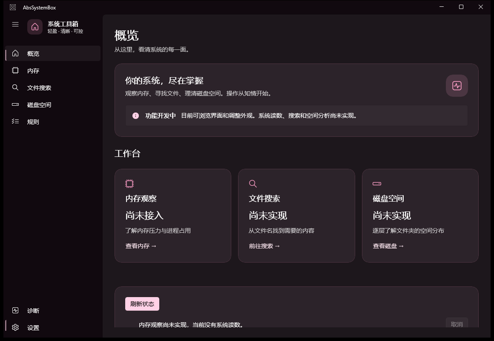

# AbsSystemBox

面向 Windows 11 x64 的原生系统工具箱，计划采用 C#、.NET 10、WinUI 3，
实现内存观察、自主文件名索引与搜索、目录大小分析和受控规则。
不依赖 Everything、WizTree、Mem Reduct 或 Fluent Reduct 运行。

**当前阶段：M1 原生桌面界面。** 已有主窗口、七页导航、粉色主题、毛玻璃背景，
支持浅色、深色和跟随系统。内存采集、文件搜索和磁盘分析尚未实现，页面明确显示占位状态。
当前没有安装器，进度以 [开发状态](docs/STATUS.md) 为准。




## 构建与测试

安装 [微软 .NET 10 SDK](https://dotnet.microsoft.com/download/dotnet/10.0)，
版本由 `global.json` 固定。运行时不能代替 SDK。
完整 Solution 需要 Windows x64 开发环境，建议使用 Visual Studio 2026 和 Windows SDK。
UI 基于微软官方 WinUI 模板，依赖版本已固定并保存 NuGet 锁文件。
纯核心与 ViewModel 测试不需要图形桌面或管理员权限。

```powershell
dotnet restore SysBox.slnx --locked-mode
dotnet build SysBox.slnx -c Debug --no-restore
dotnet test SysBox.slnx -c Debug --no-build --no-restore
```

也可运行 `./scripts/build.ps1` 和 `./scripts/test.ps1`。
脚本优先使用存在于 `.tools/dotnet/` 的本地 SDK，否则使用 PATH 中的 `dotnet`。
本地 SDK 与依赖缓存不提交，也不属于应用运行时。

## 启动桌面界面

构建完成后，在 PowerShell 中运行：

```powershell
& ./src/SysBox.App/bin/x64/Debug/net10.0-windows10.0.26100.0/win-x64/SysBox.App.exe
```

当前使用 unpackaged、自包含的 .NET 和 Windows App SDK 开发输出。
请保留整个输出目录，不能只复制一个 EXE。无需部署 MSIX、注册服务或以管理员身份启动。
在 Visual Studio 中，将 `SysBox.App` 设为启动项目，选择 x64 和 `SysBox.App (Unpackaged)` 配置。

仅 Debug 构建可显式传入 `--demo` 预览模拟内存数据，窗口会持续显示“示例预览”警示。
正常模式不生成系统读数；Release 忽略该参数，且不编译模拟数据实现。
主题设置本次会话内生效，退出窗口即结束应用；尚无托盘或后台进程。

原生界面自动化（需要可交互 Windows 桌面）：

```powershell
powershell.exe -NoProfile -ExecutionPolicy Bypass -File ./scripts/ui-smoke.ps1
powershell.exe -NoProfile -ExecutionPolicy Bypass -File ./scripts/ui-smoke.ps1 -Demo
powershell.exe -NoProfile -ExecutionPolicy Bypass -File ./scripts/ui-smoke.ps1 -Configuration Release -Demo
```

运行报告和仅包含本应用窗口的截图写入 `artifacts/ui/`。
详见 [界面设计与验收范围](docs/UX.md)。

## 开发资料

- [实施手册](docs/SYSBOX_MASTER_PLAN.md)：原始开发规划，示例代码不是实现结果。
- [架构](docs/ARCHITECTURE.md)、[接口](docs/API.md)、[安全边界](docs/SECURITY.md)。
- [路线图](docs/ROADMAP.md)、[贡献指南](CONTRIBUTING.md)。

仓库名称为 AbsSystemBox，内部程序集沿用手册的 `SysBox.*` 名称。
本阶段不扫描用户文件、不配置规则或后台服务。

## 许可证

Copyright (C) 2026 Johnson-Tang2019 and AbsSystemBox contributors.

本项目采用 **GPL-3.0-or-later**，即 GNU GPL 第 3 版或任何后续版本。
完整原文见 [LICENSE](LICENSE)，项目声明见 [COPYING.md](COPYING.md)，
依赖声明见 [THIRD_PARTY_NOTICES.md](THIRD_PARTY_NOTICES.md)。本项目不提供担保。
