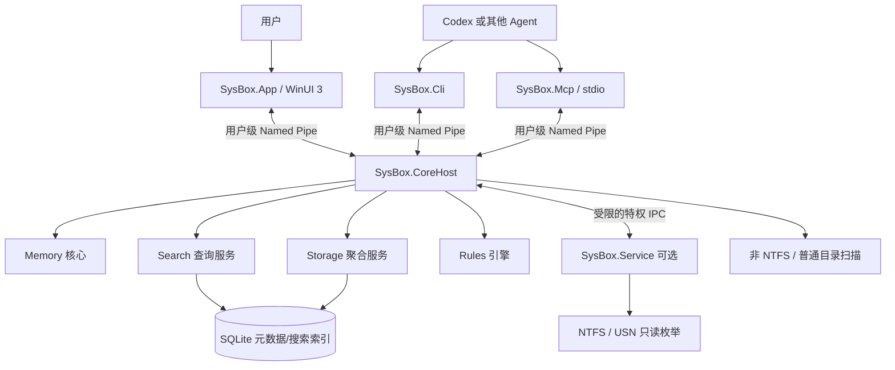
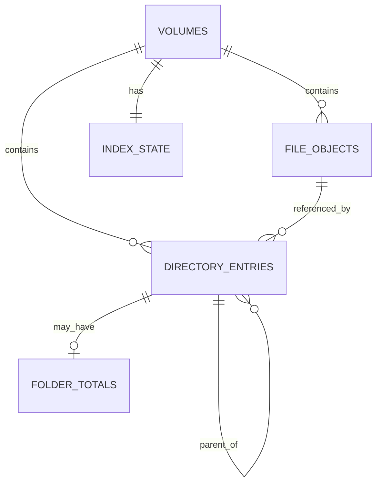
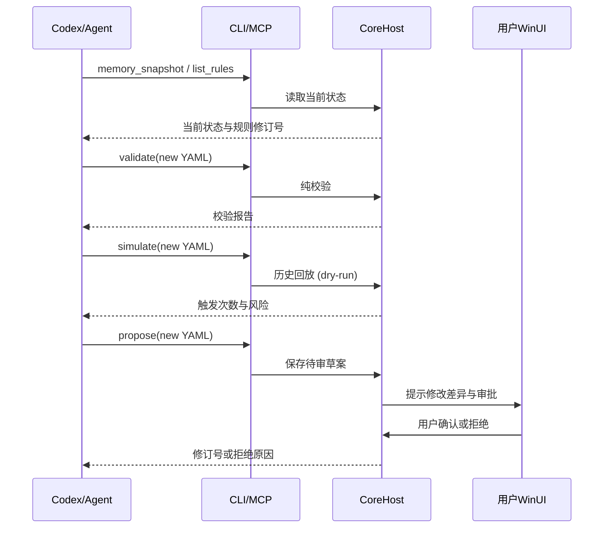

# SysBox：Windows 11 原生系统工具箱完整开发实施手册

> **文档用途**：可直接作为人类开发者的实施教材，以及交给 Codex、GitHub Copilot 等编程 Agent 的项目总规范。  
> **项目代号**：`SysBox`（暂定名称，后续可全局更名）  
> **目标平台**：Windows 11 x64，兼顾 Windows 10 受支持版本；**仅开发 Windows 桌面端**。  
> **技术基线**：C#、.NET 10、WinUI 3、Windows App SDK 稳定通道、SQLite、Win32 P/Invoke。  
> **核心约束**：无 Electron、无 Chromium、无 WebView2 UI、无 Node.js 运行时；不依赖 Everything、WizTree、Mem Reduct 或 Fluent Reduct 运行；支持 Codex 通过 CLI / MCP 安全访问和调整规则。  
> **编写日期**：2026-10-26。文中 API 以微软和相关项目的公开文档为依据；具体 NuGet、Windows SDK 和模板版本以实际安装时的稳定版为准。

---

## 使用方法与阅读路线

这是**开发路线图 + 技术架构说明 + 项目任务书 + 测试计划 + Agent 执行协议**，并非一份“所有源码均已实现”的宣称。

**建议第一次开发按以下路线执行：**

1. 阅读第 1～6 章，确定产品范围、版本和目录结构。
2. 完成里程碑 M0～M3，先得到能运行的 WinUI 3 内存监控应用。
3. 完成 M4～M6，实现不依赖 Everything 的自主文件索引与搜索。
4. 完成 M7～M8，实现文件夹大小、逐层导航和 Treemap。
5. 完成 M9～M11，再加入特权服务、CLI/MCP、安装与发布。
6. 每次只向 Codex 下发**一个里程碑的一个子任务**；验证后再继续，不能让 Agent 一次性生成整个工程。

**文内标记：**

- **[MVP]**：第一版必须实现。
- **[V1]**：正式 1.0 推荐实现。
- **[Later]**：后续迭代。
- **[Risk]**：需要安全审查或特殊测试。
- **[Pseudo]**：示意代码/接口，不能视为已经编译验证的成品。

> **首要产品原则**：让 Windows 更易观察、更易定位问题，而不是靠反复强制释放缓存制造“内存占用数字好看”的错觉。搜索、磁盘分析、内存管理都必须以真实数据、低资源开销、可解释结果与可恢复操作为中心。

---

# 第 1 章：产品定义与边界

## 1.1 产品定位

SysBox 是一款独立的 Windows 系统工具箱，重点替代以下软件**功能上的常用部分**，但不运行它们的程序：

| 参考产品 | 自主实现的能力 | 技术依据 | 运行时依赖原软件？ |
|---|---|---|---|
| Fluent Reduct / Mem Reduct | 内存状态、进程诊断、受控清理与自动规则 | Windows 内存/进程 API | 否 |
| Everything | 文件名即时搜索、索引增量维护、快捷搜索窗 | NTFS MFT 枚举与 USN Journal | 否 |
| WizTree / TreeSize | 文件夹累计大小、子目录排行、矩形树图 | 自主文件元数据索引与大小聚合 | 否 |
| 任务管理器的一部分 | 进程内存观察和排序 | Win32、性能计数器 | 否 |
| PowerToys Run 的一部分 | 全局搜索快捷键、启动/定位文件 | RegisterHotKey、ShellExecuteEx | 否 |

不要承诺与上述产品完全功能等价。第一版不做全盘内容搜索、不做杀毒、不做注册表清理、不做驱动优化、不做重复文件自动删除、不做资源管理器的完整替代品。

## 1.2 典型使用场景

**场景 A：电脑卡顿。** 打开仪表盘，看到可用内存、提交量、占用最高的用户进程；规则引擎判断是否存在持续压力，给出可解释提示。用户确认后才执行特定、受保护的优化动作。

**场景 B：寻找模型权重。** 按 `*.pth`、`*.pt`、`*.onnx` 或关键字查找文件，按大小排序，双击定位、复制完整路径，右键直接打开其所在目录。

**场景 C：磁盘快满。** 点击 `D:`，立即显示各顶层文件夹累计大小；点击 `Datasets` 进入下一层，同时更新排行、比例条与矩形树图；可以用面包屑返回父级。

**场景 D：通过 Codex 改变行为。** Codex 使用 `sysbox memory status --json` 查询事实，提交新的 `memory-rules.yaml` 草案，调用 `validate` 和 `simulate`，在用户确认后才 `apply`，并可回滚上一个版本。

**场景 E：不运行界面仍可搜索。** 关闭 WinUI 窗口后，可配置 CoreHost 继续索引和响应快捷键。用户也可以选择“完全退出”，令后台索引及监控停止。

## 1.3 需求分级

### P0：最小可用版本 [MVP]

- WinUI 3 主窗口，支持深浅主题与基本导航。
- 内存总量、可用量、使用百分比、提交压力等状态读取。
- 进程内存列表：PID、名称、路径（若有权限）、工作集、私有字节（可选）。
- 声明式规则读取、Schema 校验、干运行、版本备份，默认只通知。
- 文件名索引：第一阶段先用目录遍历，后续加入 NTFS 快速路径。
- 文件名搜索、结果排序、打开文件/所在文件夹。
- 目录大小递归统计（限选定目录）、逐层查看和进度状态。
- 基本错误信息、日志、取消操作。

### P1：正式版 [V1]

- NTFS `FSCTL_ENUM_USN_DATA` 初次枚举与 `FSCTL_READ_USN_JOURNAL` 增量同步。
- 多卷管理、断点恢复、索引数据库与一致性自检。
- 后台 CoreHost、单实例与托盘、全局快捷键。
- 磁盘 Treemap，目录分层排行，大小统计精度标识。
- 有界资源占用，扫描暂停/限速/后台优先级设置。
- 只读 CLI 与 MCP；有审计的规则提案/审批流程。
- 可选特权组件，普通 UI 永不以管理员身份长期运行。
- 安装器、卸载、回滚、升级及数据迁移。

### P2：后续功能 [Later]

- 自定义搜索语法、正则、拼写容错、搜索收藏夹。
- 多种文件系统、网络磁盘及 NAS 更完善适配。
- 近重复文件分析（只分析，不自动删除）。
- 体积变化历史趋势、磁盘空间报警与来源追踪。
- 内容索引（**默认关闭**，必须单独征得用户同意）。
- C++ 或 Rust 原生加速库（仅在基准测试证明值得之后）。
- Windows Shell 扩展、文件内容预览、可选插件系统。

## 1.4 明确禁止

1. 不因为想实现“即时搜索”而读取/上传文件正文、凭据或浏览历史。
2. 不创建无保护的管理员服务，不提供“执行任意命令”之类的高权限代理接口。
3. 不在默认配置中定时清空系统 Standby List、系统缓存或所有进程工作集。
4. 不在没有确认时删除文件、不强制结束用户进程。
5. 不为了减少代码量重新嵌入 WebView2 / Electron。
6. 不把 SQLite、Windows 系统 DLL 或普通 NuGet 类库误认为“依赖第三方**应用程序**”：这些是可随程序分发的基础组件，允许使用；但必须检查许可证和运行时部署条件。

## 1.5 成功标准

一位普通用户应当能在没有安装 Everything、WizTree、Mem Reduct 的全新 Windows 11 环境中：安装 SysBox → 完成初始化 → 搜索文件 → 分析指定盘符 → 查看内存 → 编辑/验证规则 → 正常卸载。全过程不需常驻管理员身份，索引失败会明确提示，且不会影响原有文件。

---

# 第 2 章：技术路线与决策记录

## 2.1 统一技术栈

| 层级 | 方案 | 理由 | 何时可能调整 |
|---|---|---|---|
| UI | WinUI 3 + XAML | 原生 Fluent 设计、Windows 11 视觉一致 | 不调整 |
| 语言 | C# / .NET 10 | 易于 Codex 维护、工具生态成熟 | 底层热点可局部换 C++ |
| 原生 API | P/Invoke + `SafeHandle` | 直接访问 Win32 / 文件系统控制码 | 高负载时可做 Native DLL |
| 后台 | .NET Generic Host | 日志、DI、生命周期与定时任务 | 不调整 |
| 本地通信 | Windows Named Pipes | 本机 IPC，无 HTTP 监听端口 | 极小单进程原型可先直连接口 |
| 元数据存储 | SQLite + WAL | 嵌入式、事务、无需数据库服务 | 索引规模特别大时再评估自定义结构 |
| 搜索索引 | SQLite B-tree + 可选 FTS5 trigram | 易实现、可测试 | 需按真实延迟和磁盘体积优化 |
| 规则 | YAML + JSON Schema + 强类型 DTO | 人类/Agent 可读写并校验 | 不允许直接执行脚本 |
| CLI | 独立 `sysbox.exe` | Agent、PowerShell、批处理通用 | 不调整 |
| MCP | 官方 ModelContextProtocol C# SDK / stdio | 便于 Codex 等接入 | 后续有必要时再评估本地 HTTP |
| 打包 | 首选传统 EXE 安装器 + unpackaged WinUI 部署 | 对可选 Windows 服务安装较灵活 | 也可另做 MSIX 版（评估服务限制） |

**为什么不是 C++ 全栈？** 可以获得更低级控制，但重写 UI、异步、配置、测试和 Agent 工具接口的工程成本明显增加。先通过测量找热点，才有必要复杂化。

**为什么不直接全部塞进 WinUI 进程？** UI 崩溃或关闭时，索引不应中断；文件扫描也不能堵塞 UI 线程；权限隔离在单进程内更难建立。

**为什么不把后台全部做成 Windows 服务？** 不是所有任务都需要管理员权限。用户态 CoreHost 足以做搜索数据库、常规目录扫描、内存观察、规则调度；只有确有必要的卷级操作才交给可选特权服务。

## 2.2 架构图



**进程职责：**

- `SysBox.App`：只负责 UI、展示、用户确认；尽量无系统管理权限。
- `SysBox.CoreHost`：普通用户会话内的工作进程，拥有用户级 SQLite 数据库，编排 Memory/Search/Storage/Rules。
- `SysBox.Service`：可选且经过安装授权的服务，只暴露少数受限底层读取功能；严禁通用文件删除和任意 API 转发。
- `SysBox.Cli`：一次性短命令进程，机器可读输出、稳定退出码。
- `SysBox.Mcp`：stdio 子进程，由 Agent 主机按需启动，通过 CoreHost 提供经过限制的工具。

**重要**：早期 M0～M3 可用同进程调用 `Core` 接口作为开发捷径，但接口仍要可替换为 IPC；不能让 ViewModel 直接引用原生 `DeviceIoControl`。

## 2.3 关键 ADR（架构决策）

| 编号 | 决策 | 后果 |
|---|---|---|
| ADR-001 | WinUI 3 而非 Electron | 跨平台不是目标；完全原生 Windows UI |
| ADR-002 | CLI/API 优先，UI 只是一个调用方 | 可被 Codex 调用、易自动化测试 |
| ADR-003 | 搜索和磁盘分析共用文件元数据 | 避免重复枚举；也意味着数据库一致性非常重要 |
| ADR-004 | NTFS 快速路径 + 目录遍历后备 | 兼顾性能与非 NTFS/权限不足 |
| ADR-005 | 内存清理默认只读、默认不执行危险动作 | 低风险，结果可解释 |
| ADR-006 | 特权操作与用户进程隔离 | 避免 Agent 间接获得系统权限 |
| ADR-007 | YAML 规则必须经过 Schema/语义校验 | 不允许任意表达式或外部命令 |
| ADR-008 | Agent 写入规则采用提案 → 审查 → 应用 | 支持自动生成但保留人类控制 |
| ADR-009 | 所有大任务可暂停、取消、断点恢复 | 避免持续抢占系统资源 |
| ADR-010 | 不承诺固定“低于 X MB”或“X 秒扫描完” | 性能目标必须以测试硬件和数据量说明 |

## 2.4 开源、授权与独立性

Fluent Reduct 仓库说明使用 `GPL-3.0-or-later`。我们建议**只参考公开功能描述和 Windows API 文档，独立实现**，避免直接复制其源代码、样式资源或受保护素材。如果复制/改编 GPL 代码，必须按相应许可证履行义务；不要假定改成 C# 或换 UI 就能消除许可证要求。

每一个 NuGet 或 SDK 都需记录：项目名称、版本、许可证、源地址、用途、随包分发的文件。见 `THIRD_PARTY_NOTICES.md`。

---

# 第 3 章：开发环境准备（Windows）

## 3.1 硬件与系统

最低开发环境建议：

- Windows 11 x64，管理员权限只用于启用开发模式、安装 SDK/服务、调试底层文件系统；日常运行非管理员。
- 16 GB 内存开发更舒适；8 GB 也可编写和测试，只需避免同时打开大量 IDE。
- SSD 上至少留出 20 GB 开发/临时空间。索引测试最好使用专门的样本目录，**不要一开始扫描整盘**。
- IDE：Visual Studio 2026（若所选 Windows App SDK 模板需要），同时可使用 VS Code + Codex。
- SDK：.NET 10 SDK、WinUI 开发工作负载、Windows SDK（与 Windows App SDK 稳定通道兼容）。
- 工具：Git、PowerShell 7（可选）、Windows Terminal、SQLite 命令行工具（仅开发验证使用）。

> 已有 Visual Studio 2022 不意味着必须卸载它；但 WinUI 3 最新模板可能依赖更新版 IDE。用 Visual Studio Installer 安装并行版本及正确工作负载，不要猜测菜单名或固定版本号。

## 3.2 必须执行的版本检查

在 Windows Terminal / PowerShell 执行：

```powershell
winver
dotnet --info
dotnet --list-sdks
git --version
where.exe dotnet
```

预期：.NET SDK 至少包含 10.x；Git 可调用。若 WinUI 模板缺失，在 Visual Studio Installer 中安装 **WinUI application development / Windows App SDK 对应工作负载**，然后重启 IDE。

可参考官方 WinUI 3 快速入门：https://learn.microsoft.com/en-us/windows/apps/get-started/start-here

## 3.3 初始化工作目录与 Git

示例路径可按实际磁盘修改：

```powershell
New-Item -ItemType Directory -Force 'D:\Projects\SysBox'
Set-Location 'D:\Projects\SysBox'
git init
dotnet new sln -n SysBox
New-Item -ItemType Directory -Force src, tests, docs, scripts, packaging, config, benchmarks
```

**如果用户在其他位置开发，禁止 Codex 擅自移动项目或删除现有目录。**

最初建立 `.gitignore`：

```gitignore
.vs/
.vscode/
**/bin/
**/obj/
**/TestResults/
artifacts/
*.user
*.suo
*.db
*.db-shm
*.db-wal
*.log
*.tmp
*.bak
.DS_Store
```

注意数据库与日志默认保存在用户目录，不应被提交到 Git。测试所用的固定 fixture 可以放在 `tests/Fixtures`，不要用 `*.db` 提交真实用户的索引。

## 3.4 建立纯 C# 核心项目

先创建不依赖图形界面的模块：

```powershell
dotnet new classlib -n SysBox.Abstractions -o src/SysBox.Abstractions -f net10.0
dotnet new classlib -n SysBox.Core -o src/SysBox.Core -f net10.0
dotnet new classlib -n SysBox.Memory -o src/SysBox.Memory -f net10.0
dotnet new classlib -n SysBox.FileIndex -o src/SysBox.FileIndex -f net10.0
dotnet new classlib -n SysBox.Search -o src/SysBox.Search -f net10.0
dotnet new classlib -n SysBox.Storage -o src/SysBox.Storage -f net10.0
dotnet new classlib -n SysBox.Rules -o src/SysBox.Rules -f net10.0
dotnet new worker -n SysBox.CoreHost -o src/SysBox.CoreHost -f net10.0
dotnet new console -n SysBox.Cli -o src/SysBox.Cli -f net10.0
dotnet new console -n SysBox.Mcp -o src/SysBox.Mcp -f net10.0
dotnet new xunit -n SysBox.UnitTests -o tests/SysBox.UnitTests -f net10.0
```

上述命令仅创建框架结构。随后按照真实依赖图执行 `dotnet sln add ...`、`dotnet add ... reference ...`，不允许循环引用。后续加入 `SysBox.Native`、`SysBox.Service`、`SysBox.IntegrationTests` 和 UI。

**WinUI 3 项目**：优先在 Visual Studio 中创建 **WinUI Blank App (Packaged)** 示例，先确认 XAML 可运行；正式应用若选择传统安装器，再按官方 unpackaged 指南切换。也可先按官方快速入门安装 `dotnet new winui` 模板，但要以当时的模板支持情况为准，不要手工猜造 `.csproj` 属性导致启动失败。

## 3.5 首次提交与分支习惯

```powershell
git add .
git commit -m "chore: initialize SysBox solution"
git branch -M main
git switch -c feat/m0-foundation
```

约定：`main` 始终能够构建；每个任务一个分支或独立提交；复杂功能使用小 PR；任何 API 改动同步更新 `docs/API.md` 和测试。

---

# 第 4 章：代码仓库与模块划分

## 4.1 推荐的正式目录结构

```text
SysBox/
├── SysBox.slnx                       # 实际可用 sln/slnx 以工具生成为准
├── AGENTS.md                         # 全局 Agent 守则
├── README.md                         # 用户安装与介绍
├── CONTRIBUTING.md
├── LICENSE                            # 选择后再添加
├── THIRD_PARTY_NOTICES.md
├── .editorconfig
├── .gitignore
├── Directory.Build.props
├── Directory.Packages.props            # 可选：集中管理 NuGet 版本
├── src/
│   ├── SysBox.Abstractions/           # DTO、接口、错误码、数据契约
│   ├── SysBox.Core/                   # 生命周期、配置、日志、事件流
│   ├── SysBox.Native/                 # SafeHandle / Win32 PInvoke / 结构体
│   ├── SysBox.Memory/                 # 内存采集与操作
│   ├── SysBox.Rules/                  # 校验、模拟、审批、快照、回滚
│   ├── SysBox.FileIndex/             # 枚举器、USN、索引同步、数据库
│   ├── SysBox.Search/                # 查询解析、过滤、排名
│   ├── SysBox.Storage/               # 目录大小、空间分布、Treemap 数据
│   ├── SysBox.CoreHost/              # 用户态后台进程 / 用户管道服务
│   ├── SysBox.Service/               # 可选 Windows 特权服务
│   ├── SysBox.App/                   # WinUI 3 XAML、ViewModels、主题
│   │   ├── Views/
│   │   │   ├── DashboardPage.xaml
│   │   │   ├── MemoryPage.xaml
│   │   │   ├── SearchPage.xaml
│   │   │   ├── StoragePage.xaml
│   │   │   ├── RulesPage.xaml
│   │   │   ├── SettingsPage.xaml
│   │   │   └── DiagnosticsPage.xaml
│   │   ├── ViewModels/
│   │   ├── Controls/
│   │   ├── Converters/
│   │   ├── Services/
│   │   └── Assets/
│   ├── SysBox.Cli/
│   └── SysBox.Mcp/
├── tests/
│   ├── SysBox.UnitTests/
│   ├── SysBox.IntegrationTests/
│   ├── SysBox.ContractTests/
│   ├── SysBox.UiTests/               # 环境成熟后建立
│   ├── Fixtures/
│   └── TestDataGenerator/
├── benchmarks/
│   ├── IndexBenchmark/
│   ├── SearchBenchmark/
│   └── MemoryBenchmark/
├── docs/
│   ├── ARCHITECTURE.md
│   ├── API.md
│   ├── DATABASE.md
│   ├── SECURITY.md
│   ├── UX.md
│   ├── PERFORMANCE.md
│   ├── ROADMAP.md
│   ├── STATUS.md
│   ├── ADR/
│   └── tasks/
├── config/
│   ├── memory-rules.example.yaml
│   ├── memory-rules.schema.json
│   └── settings.example.json
├── scripts/
│   ├── bootstrap.ps1
│   ├── build.ps1
│   ├── test.ps1
│   ├── benchmark.ps1
│   └── verify-release.ps1
└── packaging/
    ├── installer/
    └── release-notes/
```

## 4.2 模块依赖纪律

允许：

```text
App -> Abstractions, Core client
Cli -> Abstractions, Core client
Mcp -> Abstractions, Core client
CoreHost -> Memory / Rules / FileIndex / Search / Storage / Core
FileIndex -> Native / Abstractions
Memory -> Native / Abstractions
Storage -> FileIndex / Abstractions
Search -> FileIndex / Abstractions
Rules -> Abstractions
```

禁止：`FileIndex -> App`、`Memory -> UI`、`Native -> SQLite`、`Service -> UI`。任何数据库字段都不应直接暴露为 UI 视图状态。

## 4.3 统一业务契约

```csharp
// [Pseudo] 接口草案：编译前由 Codex 按具体 DTO / CancellationToken 完善
public interface IMemoryMonitor
{
    Task<MemorySnapshot> ReadAsync(CancellationToken cancellationToken);
}

public interface IFileSearchService
{
    IAsyncEnumerable<FileSearchHit> SearchAsync(
        FileSearchRequest request,
        CancellationToken cancellationToken);
}

public interface IStorageAnalyzer
{
    Task<FolderSummary> AnalyzeAsync(
        string path,
        CancellationToken cancellationToken);
}

public interface IRuleService
{
    Task<ValidationReport> ValidateAsync(string yaml, CancellationToken ct);
    Task<SimulationReport> SimulateAsync(string yaml, CancellationToken ct);
    Task<RuleProposal> ProposeAsync(string yaml, CancellationToken ct);
}
```

规范：

- 接口接收 `CancellationToken`，严禁 UI 等待不可取消的全盘扫描。
- 跨进程 DTO 有 `apiVersion`、错误码、单位、时间戳、数据完整度。
- 不把任意异常字符串作为唯一协议；`Result<T>` 或标准错误响应含 `code`、`message`、`details`、`retryable`。
- 搜索要流式返回/分页；结果数默认上限，不能一次向 UI 推送百万行。
- 与文件路径有关的对象都携带 `volumeId`、`fileId`（如可用）和 `path`，不要只靠文件名作唯一键。
- 尽量让复杂模块有假实现（Mock）可在非管理员环境测试。

---

# 第 5 章：跨进程通信、配置与日志规范

## 5.1 IPC 格式

首选 Windows Named Pipes：

- 用户态管道：建议 `\\.\pipe\SysBox.User.<UserSid>`，实际名称经单实例/多会话设计确定。
- 特权服务管道：建议固定服务名，明确 ACL、允许的客户端 SID、请求/响应大小上限。
- 协议：带长度前缀的 UTF-8 JSON 帧；每条请求含 `requestId`、`apiVersion`、`method`、`params`。
- 所有命令设定上限、超时和取消；不要依赖行分隔直接传输任意二进制。
- 监听端需限制并发数与每个客户端请求数，防止任意进程触发大量扫描。

示例（规范示意，不是直接运行的管道程序）：

```json
{
  "apiVersion": "1.0",
  "requestId": "7ea680a6-34b9-483e-b05b-783144c1376a",
  "method": "search.query",
  "params": {
    "text": "*.onnx",
    "limit": 100,
    "includeHidden": false
  }
}
```

```json
{
  "apiVersion": "1.0",
  "requestId": "7ea680a6-34b9-483e-b05b-783144c1376a",
  "ok": true,
  "result": { "hits": [], "totalEstimate": 0, "hasMore": false, "indexState": "ready" }
}
```

命名管道的系统默认访问控制不等于满足本项目安全需求。必须**显式配置 ACL**、验证真实连接用户身份；特权操作要再进行每个方法级别授权。不要仅凭 JSON 参数中的 `userId` 或 `isAdmin` 字段判断权限。

## 5.2 配置存放位置

| 路径 | 用途 | 权限 |
|---|---|---|
| `%LOCALAPPDATA%\SysBox\settings.json` | 每用户 UI/扫描偏好 | 当前用户 |
| `%LOCALAPPDATA%\SysBox\memory-rules.yaml` | 生效的用户级规则 | 当前用户 |
| `%LOCALAPPDATA%\SysBox\index\` | SQLite 索引 | 当前用户，不共享 |
| `%LOCALAPPDATA%\SysBox\logs\` | 常规日志 | 当前用户 |
| `%LOCALAPPDATA%\SysBox\backups\` | 规则快照/备份 | 当前用户 |
| `%PROGRAMDATA%\SysBox\` | 服务状态与服务日志 | 管理员/服务专属 ACL |
| `%PROGRAMFILES%\SysBox\` | 安装程序文件 | 安装器管理，用户只读 |

不得把可写规则放进 `%ProgramFiles%`；不得把用户文件路径、搜索历史默认上传云端。配置更改采用“新文件写入临时文件 → 校验 → 原子替换/备份”，并保留最近 N 份版本。

## 5.3 日志与审计

三个不同层次：

1. **应用日志**：启动、异常、索引任务状态、权限和兼容性问题。
2. **性能日志**：查询耗时、扫描吞吐、内存峰值、磁盘 I/O、任务取消；默认不含原始查询词。
3. **操作审计**：规则提案、验证结果、批准人、执行时间、被影响进程、操作结果；对可执行内存操作必须保留可追溯记录。

默认本地日志，设置滚动大小和保留天数。日志中应脱敏用户名、文件路径和个人查询内容；“导出诊断包”必须展示包含项目并由用户确认。


---

# 第 6 章：自主文件索引引擎（整个项目的技术核心）

## 6.1 三种扫描路径与使用场景

**路径 A：NTFS Fast Indexer [V1]**

- 使用 `CreateFileW` 打开卷句柄，例如 `\\.\D:`（路径字面量需正确转义）。
- `FSCTL_QUERY_USN_JOURNAL` 获取 Journal ID、当前 FirstUsn / NextUsn。
- `FSCTL_ENUM_USN_DATA` 迭代取得 MFT 的文件/目录记录；解析文件引用 ID、父引用 ID、名称、属性。
- 从记录组织文件目录关系并持久化到 SQLite。
- 利用 `FSCTL_READ_USN_JOURNAL` 进行增量跟踪。
- 获取文件大小时另调元数据 API，不可把 USN 当作大小来源。

**路径 B：普通目录扫描 [MVP]**

- `Directory.EnumerateFileSystemEntries` 或原生 `FindFirstFileExW` / `FindNextFileW`。
- 子树遍历可限速、取消、暂停、排除路径。
- 根据选择的目录记录逻辑路径、文件类型、长度、日期。
- 可搭配 `FileSystemWatcher` / `ReadDirectoryChangesW` 观察变化。
- 适用于一般目录、非 NTFS、没有管理员权限的情况；不承诺全盘即时更新。

**路径 C：只读一次性分析 [MVP]**

- 用户对某个文件夹发起一次扫描。
- 扫描结束后不要求后台持续追踪。
- 适合移动硬盘、外部共享、网络盘以及用户不希望常驻索引的情况。

> 不要将「MFT 等价于直接读取 `$MFT` 原始磁盘扇区」混为一谈。优先使用微软支持的 `FSCTL_ENUM_USN_DATA` 控制接口，而不是自行读取、解析 NTFS 原始元文件或扇区；后者复杂、兼容性与权限问题更多。

## 6.2 卷的发现和身份识别

建议 `IVolumeDiscovery` 枚举系统卷，而不是硬编码 C/D/E。需要采集：

- 卷 GUID 路径：例如 `\\?\Volume{...}\`。
- 当前盘符/挂载点列表；盘符不是稳定身份。
- 文件系统类型：NTFS、ReFS、exFAT、FAT32、网络文件系统等。
- 卷序列号、是否可移动、是否可读、是否可使用 USN。
- 根目录、总空间、可用空间、扫描模式、最近成功检查时间。
- 是否需要管理员权限、是否已经得到许可。

**原则**：持久数据库按稳定卷身份分区，不按 `D:` 作为唯一主键。用户改盘符时仍需正确识别原卷；但卷身份重用、格式化和盘克隆等边界情况应检测并提示重建。

建议适配器接口：

```csharp
public interface IVolumeIndexer
{
    string Name { get; }
    bool CanHandle(VolumeInfo volume, IndexCapabilities capabilities);
    Task<IndexRunReport> BuildAsync(VolumeInfo volume, CancellationToken ct);
    Task<IndexRunReport> UpdateAsync(VolumeInfo volume, CancellationToken ct);
}
```

**后续扩展**：`NtfsUsnIndexer`、`DirectoryWalkIndexer`、`ReFsIndexer`、`NetworkShareIndexer`。先实现前两种；ReFS 不直接套用 NTFS V2 文件 ID 或属性读取逻辑。

## 6.3 MFT 枚举的完整流程 [V1]

### 初始化

1. 检测卷文件系统为 NTFS，用户已明确允许索引此卷。
2. 通过受控特权服务打开卷句柄，选择最小必需访问权限。
3. `DeviceIoControl(FSCTL_QUERY_USN_JOURNAL)` 读取 Journal ID / NextUsn / FirstUsn。
4. 记录扫描起点 `(journalId, startUsn = NextUsn)`，为扫描期间的变更预留回放能力。
5. 创建临时索引 generation，不直接覆盖上一个可用版本。

### 迭代

1. 构造 `MFT_ENUM_DATA_V0`（或明确支持时的版本）。
2. `StartFileReferenceNumber` 第一次填 0，后续使用返回缓冲区开头给出的续扫位置。
3. 调用 `DeviceIoControl(FSCTL_ENUM_USN_DATA, ...)`。
4. 解析返回的 USN 记录流：检查每条 `RecordLength`、版本、长度边界、文件名偏移和长度。
5. 存储 `(VolumeId, FileId, ParentFileId, Name, Attributes, IsDirectory, LastUsn)`。
6. 使用批量事务写入，定时更新 UI 的扫描进度。
7. 直到枚举完成（终止状态须按官方 API 返回码处理，不能把所有失败都视作正常结束）。

### 补齐与切换

1. 解析父目录引用、构建路径和目录层级；检测孤儿引用、循环引用、无法解析的父目录。
2. 再次检查 Journal ID、FirstUsn、NextUsn。
3. 自 `startUsn` 起顺序回放扫描期间的变更记录，并更新到新的检查点。
4. 若日志已截断到 `startUsn` 之后，或 Journal ID 改变，**不要认为索引已完整**：标记不可信并重建或执行可靠的差异恢复。
5. 完成一致性校验后，将新的 generation 设为当前可用索引。
6. 文件大小补采集可独立异步执行，不阻塞“文件名可搜索”的时刻。

### 非常容易写错的地方

- `USN_RECORD_V2` 和 `USN_RECORD_V3` 的文件 ID 字段布局不同；必须根据 MajorVersion 分派解析，不可强行按一个结构解释所有记录。
- 文件名是 UTF-16，按长度字段解码；不能假设以 `\0` 结尾。
- 缓冲区开头可能含续读位置，不是普通记录；必须明确跳过控制字段。
- `RecordLength` 不合法、偏移越界、数据截断时应直接报错并停止当前批次，避免野指针或假路径。
- 文件引用 ID 有可能被复用，不能只使用单一 `FileId` 判断跨时段的对象身份；必要时结合 Journal 事件、生成代数、父目录、名称、元数据和重新验证。
- 硬链接可以有多个目录项对应同一文件对象；“一个 FileId 对应一个路径”的简化设计有缺陷。
- 异常断电、休眠恢复、快速启动、磁盘卸载再挂载都必须重新验证卷身份和 Journal 连续性。
- 仅把 `USN_REASON_RENAME_NEW_NAME` 当作完整改名会漏掉旧名称移除；需要综合同一 FileId 的记录并确认结果。

## 6.4 USN 增量更新状态机 [V1]

```text
UNINITIALIZED
     |
     v
BUILDING ---错误/取消---> PARTIAL
     |
     v
CATCHING_UP  ---> 检查 Journal 连续性
     |                  |
     | 连续             | 断档 / ID 变更
     v                  v
READY <---重建完成--- REBUILD_REQUIRED
     |
     +--> PAUSED
     +--> DISCONNECTED
     +--> DEGRADED
```

建议保存每卷状态：

```json
{
  "volumeId": "sample-volume-guid",
  "generation": 8,
  "state": "ready",
  "journalId": "123456789012345",
  "checkpointUsn": "9876543210",
  "lastSuccessfulSyncUtc": "2026-10-26T00:00:00Z",
  "fileCount": 1523040,
  "folderCount": 85021,
  "sizeCoverage": 0.73,
  "schemaVersion": 1
}
```

**为什么 USN 用字符串？** 在 JSON 传输中，64 位整数超过 JavaScript 安全整数范围可能丢失精度。建议文件 ID 和 USN 使用原始字符串或明确的 Base64/十六进制编码；C# 内部继续使用安全的整型/字节结构。

增量同步伪代码：

```text
function SyncVolume(volume):
    state = LoadState(volume)
    journal = QueryUsnJournal(volume)
    if journal.Id != state.JournalId:
        MarkRebuildRequired("journal-id-changed")
        return
    if state.CheckpointUsn < journal.FirstUsn:
        MarkRebuildRequired("journal-truncated")
        return
    batch = ReadUsnJournal(from = state.CheckpointUsn)
    for each record in batch:
        ParseAndValidate(record)
        ApplyChangesIdempotently(record)
        QueueSizeRefreshIfNecessary(record)
    commit transaction(changes, nextCheckpoint)
```

`nextCheckpoint` 应来自实际成功读取及回放的最后位置，而不是盲目设成当前 `journal.NextUsn`。**数据更新和 checkpoint 更新必须同一事务提交**；失败时宁可重放同一批，也不要产生不可恢复的数据缺口。

## 6.5 普通目录扫描算法 [MVP]

推荐**显式栈/队列**而非递归调用，以减少深层目录的调用栈风险：

```text
stack = [root]
while stack not empty:
    check cancellation / pause / IO budget
    folder = pop(stack)
    try enumerate direct children:
        for each child:
            if excluded: continue
            if reparse point: record link; do not auto-follow
            store child metadata
            if child is ordinary directory: push(child)
    catch UnauthorizedAccessException:
        mark folder as PARTIAL and record access denied
    catch IOException / DirectoryNotFoundException:
        mark folder as STALE / SKIPPED
commit in batches
```

优化建议：

- 单 SSD 扫描不要开上百个并发任务；起点推荐 2～4 个目录枚举 worker，再据实测调整。
- 机械硬盘通常串行或极小并发更友好，避免随机寻道。
- 使用 `EnumerationOptions` 时明确隐藏目录、无权限处理、重解析点策略。
- 默认不穿透 junction / symlink 进入其他盘符或重复树；可在 UI 中显示其目标但不递归。
- 长路径需测试 `\\?\` 前缀与 .NET 路径处理；Windows 和不同 API 的支持程度并不完全一致。
- 网络盘、权限不足目录必须有“部分结果”标记，不能显示为精确值。

## 6.6 USN 与目录通知的优缺点

| 特性 | USN Journal | 目录通知 |
|---|---|---|
| Windows 接口 | `FSCTL_READ_USN_JOURNAL` | `ReadDirectoryChangesW` |
| 跨重启补增量 | 日志仍连续时可 | 通常不可直接靠通知恢复 |
| 卷级追踪 | 是 | 需要管理具体目录/子树 |
| 是否需要特权 | 卷级 USN 常要求管理员 | 普通目录视权限而定 |
| 日志溢出风险 | Journal 被截断或 ID 变化 | 通知缓冲溢出 |
| 非 NTFS 兼容性 | 按文件系统能力判断 | 覆盖更广，但行为各异 |

使用 `ReadDirectoryChangesW` 时需处理 `ERROR_NOTIFY_ENUM_DIR` 或缓冲溢出：发生时对相关目录**重枚举**而非假装没丢事件。

## 6.7 多硬链接、重解析点与特殊文件 [Risk]

建议数据库明确区分两个概念：

1. **FileObject**：同一卷内由文件标识符代表的文件对象。
2. **DirectoryEntry**：一个目录中可见的 `(parent, name)` 链接/路径入口。

多个 DirectoryEntry 可引用同一个 FileObject（硬链接），而符号链接/目录联接代表重解析点，不得盲目展开造成环路或跨卷重复计数。NTFS MFT/USN 记录对于硬链接名称集合的暴露并不等于一个完备的“所有路径列表”；精确多路径需求需要另行验证链接枚举策略，例如受支持时使用 `FindFirstFileNameW` 等接口，或结合目录遍历。

建议第一版：

- 列出可获得的硬链接路径，标记“链接集合可能不完整”。
- 文件夹**按目录项逻辑大小**统计可以存在硬链接重复；必须解释口径。
- “卷唯一文件对象大小”按 `(VolumeId, FileId)` 去重，但不将其简单等同于真实磁盘占用。
- 不跟踪重解析点目标；用户主动开启跟随时必须做已访问集合和最大深度限制。
- 云端占位文件、离线文件、WOF 压缩、EFS、ADS、稀疏文件、NTFS 压缩会影响大小解释。不要为了收集大小而主动水合云文件或读取完整文件正文。

---

# 第 7 章：数据库设计与一致性

## 7.1 数据模型



字段说明：

- `volumes`：稳定卷键、文件系统、挂载点、容量、状态。
- `file_objects`：卷内文件 ID、属性、大小、修改时间、元数据可靠性。
- `directory_entries`：父目录引用、文件名、所属文件对象、目录标记、路径解析缓存。
- `folder_totals`：目录逻辑总大小、分配大小、统计时间、完整性标志。
- `index_state`：USN Journal ID、checkpoint、generation、schema 版本。
- `search_names`：搜索专用索引（如 FTS5 trigram）。

## 7.2 SQL Schema（初始草案）

> 以下是供 Agent 开始设计 Migration 的示例，**不是已经通过所有 NTFS 硬链接/卷挂载场景验证的最终 Schema**。代码实现时必须写迁移脚本并做多卷/重命名/大小更新测试。

```sql
PRAGMA foreign_keys = ON;
PRAGMA journal_mode = WAL;

CREATE TABLE IF NOT EXISTS volumes (
  volume_id TEXT PRIMARY KEY,
  fs_type TEXT NOT NULL,
  display_name TEXT,
  mount_points_json TEXT NOT NULL DEFAULT '[]',
  is_online INTEGER NOT NULL DEFAULT 1,
  index_mode TEXT NOT NULL,
  created_utc TEXT NOT NULL
);

CREATE TABLE IF NOT EXISTS file_objects (
  object_id INTEGER PRIMARY KEY,
  volume_id TEXT NOT NULL REFERENCES volumes(volume_id),
  file_id BLOB NOT NULL,
  is_directory INTEGER NOT NULL,
  attributes INTEGER NOT NULL DEFAULT 0,
  logical_size INTEGER,
  allocated_size INTEGER,
  last_write_utc TEXT,
  size_state TEXT NOT NULL DEFAULT 'unknown',
  UNIQUE(volume_id, file_id)
);

CREATE TABLE IF NOT EXISTS directory_entries (
  entry_id INTEGER PRIMARY KEY,
  volume_id TEXT NOT NULL REFERENCES volumes(volume_id),
  object_id INTEGER NOT NULL REFERENCES file_objects(object_id),
  parent_entry_id INTEGER REFERENCES directory_entries(entry_id),
  parent_file_id BLOB,
  name TEXT NOT NULL,
  name_folded TEXT NOT NULL,
  cached_path TEXT,
  is_reparse_point INTEGER NOT NULL DEFAULT 0,
  is_hidden INTEGER NOT NULL DEFAULT 0,
  generation INTEGER NOT NULL DEFAULT 1
);

CREATE INDEX IF NOT EXISTS ix_entries_parent
ON directory_entries(volume_id, parent_entry_id, name_folded);

CREATE INDEX IF NOT EXISTS ix_entries_name
ON directory_entries(name_folded);

CREATE INDEX IF NOT EXISTS ix_entries_object
ON directory_entries(object_id);

CREATE TABLE IF NOT EXISTS folder_totals (
  entry_id INTEGER PRIMARY KEY REFERENCES directory_entries(entry_id),
  logical_bytes INTEGER NOT NULL DEFAULT 0,
  allocated_bytes INTEGER,
  direct_children INTEGER NOT NULL DEFAULT 0,
  completeness TEXT NOT NULL DEFAULT 'unknown',
  updated_utc TEXT
);

CREATE TABLE IF NOT EXISTS index_state (
  volume_id TEXT PRIMARY KEY REFERENCES volumes(volume_id),
  journal_id TEXT,
  checkpoint_usn TEXT,
  generation INTEGER NOT NULL DEFAULT 0,
  state TEXT NOT NULL DEFAULT 'uninitialized',
  last_success_utc TEXT
);
```

**补充约束（落地必须完成）**：

- `directory_entries` 的入口唯一性需综合 `(volume, parent, name, file object)` 以及大小写敏感策略；不能假设所有目录都大小写不敏感。
- 卷根是特殊目录，应有明确的根 `entry_id` 与 `parent_entry_id = NULL` 规则。
- `cached_path` 只是缓存；目录改名后不能靠一次修改所有子节点路径（百万子节点可能极慢）。推荐按父引用动态重建路径，并仅对热路径缓存。
- `file_id BLOB` 支持未来 128 位文件 ID；禁止转换成有符号 32 位 int。
- `entry_id` 在数据库重建后可能变化，外部 CLI/API 不应承诺它永久稳定；使用卷身份 + 文件身份/路径定位。
- 目录删除要清除相应链接与总量，避免留下“幽灵文件”；在事务内完成关联操作。
- SQLite `PRAGMA foreign_keys = ON` **需在每个连接执行**；`WAL` 模式只需建库时配置并确认。

## 7.3 搜索索引

采用两层索引：

1. SQLite B-tree：适合前缀、扩展名、路径范围、时间/大小排序过滤。
2. FTS5 `trigram`：适合文件名/路径**包含匹配**（至少三字符的典型查询）。

独立的索引表示例：

```sql
CREATE VIRTUAL TABLE IF NOT EXISTS search_names
USING fts5(
  file_name,
  full_path,
  tokenize = 'trigram'
);
```

此最简示例为了说明 tokenizer，本身不建立与 `directory_entries` 的自动同步。实际建议采用 **external-content FTS 或显式同步映射**，写入、删除、更新必须同事务同步，确定一个长期稳定的 FTS `rowid` 映射。

**重要局限**：FTS5 trigram 用 `MATCH` 搜索小于 3 个 Unicode 字符时不会正常匹配；过短查询可转为有限前缀扫描/缓存，或者明确提示。SQLite 编译必须包含 FTS5，启动时执行自检，而不是假定每个 SQLite 二进制都有此功能。

不要直接把用户搜索字符串拼接进 SQL 或 FTS 语法。必须实现参数化查询和受限搜索语法解析器。

## 7.4 数据库写入与迁移

- CoreHost 是**唯一写者**，UI、CLI/MCP 不能直接修改数据库文件。
- SQLite WAL 可支持多个读者和一个写者，但不是无限并发写入引擎。
- 建索引时批量插入，例如每批几百至数千条，根据基准调整；每批有事务。
- 长任务定期进行 WAL checkpoint；不要永久增长 WAL。
- 数据库可损坏时提示并在安全模式下重建；不得破坏用户文件。
- Migration 必须可识别当前 `user_version`/自定义 schemaVersion，升级前在安全时机备份。
- 数据库索引是**可重建缓存**，不可作为重要用户内容的唯一存放点。规则备份、用户偏好单独保存。
- 退出时完成正常 flush；异常关闭后自动运行恢复检查。

## 7.5 一致性单元测试

测试数据库以以下事件序列为核心：

```text
Create folder A
Create A/foo.txt = 10 bytes
Rename A -> B
Move B/foo.txt -> C/foo.txt
Resize C/foo.txt -> 50 bytes
Create hard link C/bar.txt -> C/foo.txt
Delete C/foo.txt
Unmount volume
Mount same volume under another letter
Truncate or replace USN Journal (模拟)
```

每一步均断言：搜索结果、路径、文件对象数、目录总大小、索引状态和 checkpoint 一致。执行真实文件系统集成测试时，**只允许在专用测试目录/测试卷中做写入和删除**。

---

# 第 8 章：搜索引擎功能与实现

## 8.1 用户交互目标

搜索结果至少显示：名称、完整路径、大小、类型、修改时间、所属磁盘、索引状态。需要支持：

- 输入即搜索（防抖 100～200ms，根据实测选择）。
- 根据文件名关键字、扩展名、路径子串筛选。
- 文件夹与文件分开筛选。
- 按相关性、路径、大小、日期排序。
- 双击打开、定位到资源管理器、复制路径；右键菜单遵循 Windows 习惯。
- 结果分页/虚拟列表、状态栏、错误提示、没有结果时的建议。
- 热键弹出轻量搜索窗口，Esc 关闭；不抢夺游戏全屏焦点。
- 右侧详情面板可展示逻辑大小、磁盘占用和父目录大小（若已计算）。

## 8.2 建议的搜索语法 [V1]

| 用户输入 | 解释 |
|---|---|
| `report` | 名称中包含 report |
| `*.pth` | 扩展名为 pth |
| `ext:onnx` | 文件扩展名精确过滤 |
| `path:D:\Projects` | 在指定路径/目录范围内 |
| `size:>1GB` | 文件大小大于 1 GB（必须明确单位） |
| `modified:>=2026-01-01` | 修改时间不早于指定日期 |
| `type:folder` | 只看目录 |
| `type:file` | 只看文件 |
| `"model final"` | 含空格的连续短语 |

需要先开发**解析器**，把输入转换成 AST，再由查询规划器生成参数化 SQL。对于不支持的语法给出提示，而不是偷偷解释成普通关键字。

```text
Raw Query
   -> Lexer
   -> Parser / AST
   -> Validate (allowed fields, operators, size/date syntax)
   -> QueryPlanner
   -> SQLite Query + bounded results
   -> Result Projection / Ranking
```

避免在 SQLite 上执行用户提交的任意 SQL。MCP 搜索也必须经过同样的解析器。

## 8.3 搜索排序

建议的排序优先级：

1. 名称完整匹配。
2. 名称前缀匹配。
3. 名称子串匹配。
4. 路径子串匹配。
5. 最近打开或常用路径（仅在用户允许本地使用历史时启用）。

当用户指定按大小或修改时间排序时，显式排序优先，相关性作为次级因素；不能因缓存尚未算出大小就默默把未知大小当作 0。

## 8.4 查询性能设计

- 所有列表默认上限 100 或 200 条；分页和“加载更多”。
- 新查询取消旧查询，防止大量并行搜索。
- 缓存热门查询结果，但在索引变更后失效。
- `COUNT(*)` 对大范围复杂查询可能昂贵，可展示“至少 N 条”或估计值。
- UI 使用虚拟化列表控件，不能对上万条结果创建上万个 XAML 控件。
- 允许索引部分完成时搜索，但明确显示“部分数据”。
- 空关键字时默认展示最近使用/提示，不全量读取全部文件。
- `LIKE '%a%'` 等短子串可能全表扫描，需要限制范围、使用有界策略或警告。

## 8.5 文件操作安全

- 默认命令：打开、复制路径、在资源管理器中显示。
- 传入路径前重新验证文件仍存在；索引信息可能陈旧。
- 不允许搜索结果直接执行恶意伪造路径中的命令行参数。
- 外部打开交给 Windows Shell，正确处理参数引号与 URI/文件路径差别。
- 对 `*.exe`、`.ps1`、`.bat` 等可执行文件，可做用户确认或突出标识，不要由 Agent 静默执行。
- 删除、移动、重命名均属于后续独立授权的写入 API，不纳入 MVP。

## 8.6 搜索完整性与状态显示

索引状态分成：`未初始化`、`正在建立`、`部分可用`、`已就绪`、`正在同步`、`已暂停`、`需要重建`、`卷不可用`、`权限不足`。UI 显示一小段原因说明，不要给普通用户一串未解释的 `HRESULT`。

---

# 第 9 章：磁盘空间分析与逐层可视化

## 9.1 两个入口，一个数据源

磁盘分析界面可从：

- 主导航 → **磁盘空间** → 选择盘符。
- 搜索结果 → 右键某文件夹 → **分析这个文件夹**。
- 资源管理器“打开方式”或未来 Shell 菜单 → **使用 SysBox 分析**。

它与搜索模块共享 `file_objects` / `directory_entries`，但需要自己的 `SizeCollector` 与 `FolderAggregationService`，因为**名称索引不等于大小索引**。

## 9.2 文件大小的三种含义

| 指标 | 定义 | 用途 | 注意 |
|---|---|---|---|
| 逻辑大小 `EndOfFile` | 文件的逻辑字节长度 | 文件列表/模型文件大小 | 稀疏、压缩文件可能占用更小 |
| 已分配大小 `AllocationSize` | 该文件所报告的分配字节数 | 近似实际分配量 | 特殊文件系统/共享簇/硬链接口径复杂 |
| 卷唯一文件大小 | 同卷同文件对象只记一次 | 分析硬链接重复 | 仍不等于卷的实际全部占用 |

通过 `GetFileInformationByHandleEx(FileStandardInfo)` 可获得 `FILE_STANDARD_INFO` 的 `EndOfFile`、`AllocationSize`、`NumberOfLinks` 等数据；可能还需使用其他 API 补充压缩大小、ReFS 特性等。不要把 `DriveInfo.TotalSize - AvailableFreeSpace` 与递归目录求和当成一定相等：系统元数据、回收站、权限、卷快照、硬链接、压缩等都会产生差异。

## 9.3 分阶段补齐大小，保证搜索先可用

**阶段 1：** 通过 MFT/目录枚举构建名称和父子关系，文件立即可搜索。  
**阶段 2：** 按需对用户点击的盘符/目录采集文件长度与分配量。  
**阶段 3：** 后台补齐更多常用目录，更新目录汇总缓存。  
**阶段 4：** 监听 USN 的大小变化相关事件，按需重新查询元数据并更新聚合。

用户打开 `D:` 时，如果完整扫描尚未完成：

- 显示目前已统计大小和完成度。
- 标注“正在计算，数字可能增大”，并提供暂停/取消。
- 不把尚未统计的目录显示成 `0 B`。
- 权限拒绝目录标注“无法访问”，不把其大小当作 0。

## 9.4 大小汇总算法

每个文件对象维护：`logicalSize`、`allocatedSize`、`sizeState`。每个文件夹维护直接内容和累计内容总量。

**初始汇总：**

1. 收集文件的大小。
2. 将直接文件累计到父目录。
3. 按目录树的深度**从深到浅**计算子目录累计大小。
4. 将统计时间、来源、完整度一起存储。
5. 汇总发现失联/循环/跨卷父级时标为异常，绝不无限递归。

伪代码：

```text
for each fileEntry:
    parent.directLogical += file.logicalBytes
    parent.directAllocated += file.allocatedBytes (if known)
for each directory in descending depth:
    parent.totalLogical += directory.directLogical + directory.childTotalLogical
    parent.totalAllocated += directory.directAllocated + directory.childTotalAllocated
    parent.completeness = combine(child statuses, local errors)
```

**增量更新：**

- 文件从 1 GB 变 1.2 GB，delta = +0.2 GB，传播至所有受影响父目录。
- 文件从 A 移动到 B：从 A 祖先链减去，在 B 祖先链加上；批量/事务处理。
- 目录改名：容量通常不变，但路径缓存失效。
- 目录整体移动：需要同时更新祖先链及层级关系。
- 在计算中又发生变更：采用 generation/checkpoint 或重新验证，避免新旧快照混合。
- 若由于多硬链接导致入口统计与唯一对象统计不同，同时提供解释及大小口径切换。

## 9.5 磁盘分析 UI 交互标准

页面从上到下建议：

```text
┌─────────────────────────────────────────────────────────┐
│ 磁盘空间分析                     [暂停] [重新扫描] [设置] │
│ 此电脑 > D: > Projects > Datasets                       │
├─────────────────────────────────────────────────────────┤
│ 当前目录  120.5 GB    已统计 93%     18,320 个文件       │
│ [逻辑大小 ▼] [按大小排序 ▼] [仅文件夹 □]                 │
├─────────────────────┬───────────────────────────────────┤
│ 子目录排行          │ Treemap                           │
│ ■ DatasetA   50 GB │  ┌───────────┬──────┐             │
│ ■ DatasetB   30 GB │  │ DatasetA  │ B    │             │
│ ■ Models     20 GB │  ├─────┬─────┴──────┤             │
│ ■ Other      20 GB │  │...  │ ...        │             │
│                     │  └─────┴────────────┘             │
├─────────────────────┴───────────────────────────────────┤
│ 底部：统计错误 3 项 | 上次同步 | 索引与容量说明           │
└─────────────────────────────────────────────────────────┘
```

**交互必须实现：**

- 点击排行行或 Treemap 方块 → 进入对应目录。
- 面包屑每一级都可返回。
- 鼠标悬浮显示全路径、百分比、大小、文件数。
- 右侧或底部显示文件列表，能按大小降序定位“大文件”。
- 用统一配色标记当前层级；颜色不是唯一信息来源，确保色盲用户也能辨认。
- 目录项多于 Treemap 可显示数量时合并成“其他”；点击“其他”可查看集合。
- 目录很深时面包屑自动省略中间项，仍可跳回任一级。
- 允许用户复制路径或打开目录，不应自动删除大文件。
- 窗口缩放下布局不应溢出；鼠标滚轮、触屏、键盘导航都应有合理行为。

## 9.6 Treemap 算法

建议实现**Squarified Treemap**（更接近正方形、便于阅读），第一版可先用易于验证的 Slice-and-Dice 方案。

算法输入：`[(name, totalBytes, entryId)]`。输出：相对坐标 `(x,y,w,h)`；UI 仅负责画矩形与文字。

要求：

- 非负大小；0、未知大小不能参与正常面积归一化。
- 面积成比例，防止浮点溢出与 NaN。
- 小到看不见的项合并为“其他”。
- 10000 个子项不能创建 10000 个复杂 XAML 子控件；优先使用高效 WinUI 绘制层、虚拟化、区域合并或 Canvas 轻量元素。
- 鼠标命中测试映射到 `entryId`，不要把路径字符串当作位置标识。
- 计算和渲染分离，输入同一份数据得到确定性的布局（可单元测试）。

## 9.7 目录扫描性能策略

| 场景 | 策略 |
|---|---|
| 用户正浏览的目录 | 优先级高，先补本层大小 |
| 系统闲置时 | 低优先级后台采集 |
| 电池模式 | 可降低频率或暂停完整补采集 |
| 大型机械硬盘 | 低并发顺序 IO |
| 目录包含百万小文件 | 分批进度、可取消、避免全量 UI 刷新 |
| 稀疏/压缩/OneDrive 占位 | 不自动读取正文；尽量获取元数据 |
| 权限不足 | 保留“未知”和错误条目 |

严禁假称“已准确分析全盘”，除非覆盖率、访问结果和大小口径确实支持这个结论。


---

# 第 10 章：内存监控、诊断与安全优化

## 10.1 不要把“空闲内存越多越好”当作目标

Windows 会利用空闲物理内存缓存文件和程序数据。大量可回收缓存并不等于系统正在缺内存。主动清空工作集或系统缓存，可能让界面上“已使用 RAM”暂时变少，却导致更多软/硬缺页、页面再次载入、游戏顿卡或应用启动变慢。

**本项目真正需要优化的指标：**

- 可用物理内存是否持续不足。
- 系统提交量（Commit）是否接近上限。
- 是否持续出现明显的页面换入/换出及磁盘读取压力。
- 哪些应用持续增长、是否存在异常内存泄漏迹象。
- 用户前台应用是否流畅，而不是单次清理回收了多少 GB。

在没有完整指标前，规则默认只提示、记录、建议关闭不用的程序，**不自动清空系统缓存**。

## 10.2 必须采集的字段

| 指标 | 来源 | 频率建议 | UI 描述 |
|---|---|---|---|
| `TotalPhysicalBytes` | `GlobalMemoryStatusEx` | 2～5s | 总物理内存 |
| `AvailablePhysicalBytes` | `GlobalMemoryStatusEx` | 2～5s | 可用内存 |
| `MemoryLoadPercent` | `GlobalMemoryStatusEx` | 2～5s | 物理内存使用率（按 API 定义） |
| `CommitTotal/CommitLimit` | `GetPerformanceInfo` 等 | 2～5s | 已提交 / 提交限制 |
| `ProcessWorkingSet` | `GetProcessMemoryInfo` | 5～10s | 每个进程工作集 |
| `ProcessPrivateBytes` | 系统性能信息/API | 5～10s | 进程私有内存 |
| `PageFault/HardFault` | 后续 PDH/ETW | 较低频/按需 | 缺页趋势 |
| `ForegroundProcess` | `GetForegroundWindow` 等 | 触发检查时 | 前台应用保护 |

**单位约定**：底层统一用 `long` 字节，传输 JSON 使用整数或为 JS 客户端提供字符串精确版本，UI 根据 1024 进制显示 GiB/MiB。切勿在业务逻辑内部来回使用已四舍五入的 GB。

## 10.3 最小可用 C# 采集器示例

下面仅演示**只读物理内存采集**，适合作为 Memory 模块的第一个可编译练习。它不涉及任何清理动作：

```csharp
using System;
using System.ComponentModel;
using System.Runtime.InteropServices;

public static class NativeMemoryReader
{
    [StructLayout(LayoutKind.Sequential)]
    private struct MEMORYSTATUSEX
    {
        public uint dwLength;
        public uint dwMemoryLoad;
        public ulong ullTotalPhys;
        public ulong ullAvailPhys;
        public ulong ullTotalPageFile;
        public ulong ullAvailPageFile;
        public ulong ullTotalVirtual;
        public ulong ullAvailVirtual;
        public ulong ullAvailExtendedVirtual;
    }

    [DllImport("kernel32.dll", SetLastError = true)]
    [return: MarshalAs(UnmanagedType.Bool)]
    private static extern bool GlobalMemoryStatusEx(ref MEMORYSTATUSEX lpBuffer);

    public static (ulong Total, ulong Available, uint LoadPercent) Read()
    {
        var state = new MEMORYSTATUSEX
        {
            dwLength = (uint)Marshal.SizeOf<MEMORYSTATUSEX>()
        };

        if (!GlobalMemoryStatusEx(ref state))
            throw new Win32Exception(Marshal.GetLastWin32Error());

        return (state.ullTotalPhys, state.ullAvailPhys, state.dwMemoryLoad);
    }
}
```

**验收办法**：在普通用户权限运行，循环读取 20 次，数据范围合理；对照任务管理器的“内存”页面确认大体一致，但不同工具对“已使用”“缓存”“可用”的口径未必完全相同。

## 10.4 进程列表的采集

第一版优先读取当前用户可访问的进程：

- PID、名称、可访问时的路径。
- 工作集、私有字节、启动时间（用于辨别 PID 重用）。
- 是否前台进程，是否处于受保护名单。
- 访问状态：`ok`、`access_denied`、`exited`、`unknown`。

更新频率不宜过高；列表默认 5 秒更新，滑动期间避免强制整表重建。**不因为读取不到某个系统进程就请求 SeDebugPrivilege**。

可用 API：`Process.GetProcesses()`、`GetProcessMemoryInfo`、`QueryFullProcessImageNameW`、`GetForegroundWindow`、`GetWindowThreadProcessId`。注意部分 Win32 API 返回数据是瞬时快照，PID 随时会退出或被复用。

## 10.5 清理动作分类与默认策略

| 动作 | 默认 | 说明 |
|---|---|---|
| 提示内存紧张 | 开 | 无侵入 |
| 展示最大内存进程 | 开 | 无侵入 |
| 建议关闭闲置应用 | 开 | 只是建议 |
| 启动项管理入口 | 后续 | 需确认更改 |
| Trim 单个用户进程工作集 | **关** | 可选择，但必须保护前台/关键进程 |
| 批量 Trim 多个进程 | **关** | 需额外限额与手动确认 |
| 清理系统 Standby List | **不纳入默认自动规则** | 可能影响缓存命中与流畅性 |
| 强制结束进程 | **不作为内存清理动作** | 高风险，单独功能与确认流程 |
| 禁用页面文件/修改系统内存管理 | **禁止自动执行** | 容易导致应用崩溃与内存不足 |

`EmptyWorkingSet` 是 Windows 提供的工作集修剪 API，但它不是“无副作用释放内存”。第一次实现它之前先完成规则验证、进程排除、审计、模拟和回滚机制。

## 10.6 声明式规则文件

目标路径：`%LOCALAPPDATA%\SysBox\memory-rules.yaml`。不允许把规则写成 PowerShell 脚本或可执行 C# 动态代码。

```yaml
schema_version: 1
id: balanced-default
name: 平衡与安全
revision: 1

enabled: true

sampling:
  interval_seconds: 5
  keep_history_minutes: 30

conditions:
  all:
    - metric: available_memory_percent
      op: lt
      value: 12
      hold_seconds: 45
    - metric: committed_memory_percent
      op: gt
      value: 80
      hold_seconds: 45

cooldown:
  after_action_seconds: 1200
  max_actions_per_hour: 1

protections:
  exclude_foreground: true
  exclude_system_processes: true
  exclude_process_names:
    - Code.exe
    - Codex.exe
    - javaw.exe
    - clash-verge.exe
  min_process_age_seconds: 120

actions:
  - type: notify
    level: warning
    message: "检测到持续内存压力，请检查占用较高的应用。"

  - type: trim_working_set
    enabled: false
    selector:
      only_user_processes: true
      min_working_set_mb: 1024
      max_targets: 2
    require_interactive_approval: true

simulation:
  default_dry_run: true

observability:
  audit_enabled: true
  include_raw_paths_in_logs: false
```

**这只是 SysBox 自定义规则语法的设计目标**。开发时必须逐字段实现 DTO、解析、JSON Schema、语义校验、状态机和测试，不允许“解析后只读取了部分字段却声称规则已生效”。

## 10.7 校验不止 Schema

校验分四层：

1. **语法**：YAML 能否解析、限制别名展开、最大文件大小、最大嵌套深度；禁用危险自定义标签。
2. **类型**：字段数据类型、枚举值、必填值、Schema 版本。
3. **语义**：内存百分比必须 0～100，采样周期有最小值，冷却必须正数，`max_targets` 不得无限大，未知动作拒绝。
4. **安全**：不可选择系统进程、不可关闭前台保护、不可通过配置绕开交互确认、不可执行任意脚本/命令。

建议合理边界（需通过真实测试调整）：采样间隔不小于 2 秒，连续观察不小于一个采样周期，最大目标进程数默认不超过 2，自动动作频率严格受限。任何越界字段给出明确的错误码和字段位置。

## 10.8 规则引擎状态机

```text
Disabled
   |
   v
Observing --满足阈值但未持续足够时间--> Pending
   |                                             |
   | 不满足阈值                                 | 持续达标
   +<-------------------------------------------+
                                                 |
                                                 v
                                             Eligible
                                                 |
                              仅通知 -> Notified
                              危险动作 -> AwaitingApproval
                                                 |
                             用户拒绝 / 超时 -> Rejected
                             用户确认 -> Executing
                                                |
                                                v
                                           Cooldown
                                                |
                                                v
                                            Observing
```

要记录触发指标、采样时间段、被评估规则版本、动作候选集、排除原因、最终结果。系统睡眠、时间跳变、重启会影响 `hold_seconds`，应尽量采用单调时钟计算持续时间而不是只做墙钟日期相减。

## 10.9 规则模拟器：Agent 工作流的关键

用户或 Codex 修改规则前，能够先“回放”历史采样数据：

```text
Input:
  sample series: 10:00:00~10:30:00
  rule revision: 7
Output:
  matched windows: [10:12:35 ~ 10:13:30]
  proposed actions: 1 notify + 1 trim candidate
  excluded: javaw.exe (protected process)
  actually executed: 0 (dry-run)
  estimated freed bytes: unknown, cannot reliably predict
```

**不能声称模拟能预知清理后释放多少内存**。它只能判断规则在什么时间会触发、哪些对象可能进入候选范围、为什么被排除。

## 10.10 执行器安全守则 [Risk]

一旦用户明确允许 Trim：

1. 在 UI 中显示将要处理的进程名、PID、路径及具体操作。
2. 确认进程仍存在，检查 PID + 启动时间，避免 PID 被复用。
3. 再检查系统/安全/前台/保护名单，不能直接相信旧快照。
4. 使用最小权限打开进程句柄，访问拒绝即跳过，不尝试强制获取系统权限。
5. 执行动作前记录可用内存和进程工作集；执行后延迟观察多个采样点。
6. 返回每个进程的成功/失败，不把单个失败包装成“全部成功”。
7. 记录运行时开销和潜在副作用；自动动作进入冷却期。
8. 如果操作后系统出现明显缺页/性能恶化，提示用户禁用该动作。

**人工确认是显式 UI 动作**，而不是 Agent 传入 `confirmed=true` 就自动算用户批准。若应用在无人值守时不能弹窗，应取消或降级为通知。

## 10.11 性能与 UX 验收

- 不开界面时监控自身资源开销可测且可关闭。
- 进程列表每隔几秒更新而不明显卡顿。
- 模拟和执行是两个独立接口、独立权限。
- 禁用的危险动作不会出现在实际执行日志中。
- 当前前台游戏 `javaw.exe` / 重要进程能够受保护（排除规则按用户配置生效）。
- 失败/权限不足时报告原因，并允许用户恢复安全默认规则。

---

# 第 11 章：WinUI 3 页面与交互开发

## 11.1 页面结构

主窗口建议使用原生 `NavigationView` 左侧导航：

1. **概览**：内存、磁盘、索引状态、快捷操作卡片。
2. **内存**：总览图、进程排行、规则匹配与清理历史。
3. **搜索**：大搜索框、过滤器、文件列表、详情栏。
4. **磁盘**：盘符选择、面包屑、文件夹排行、Treemap。
5. **规则**：可视化规则编辑器、YAML 高级编辑、模拟、版本历史。
6. **诊断**：索引健康、权限、日志导出、性能基准结果。
7. **设置**：开机启动、主题、扫描范围、热键、后台退出行为。

## 11.2 视觉规范

- 优先 WinUI 原生控件，不自己模拟 Windows 风格。
- 配色：默认系统主题，深色/浅色/跟随系统，使用动态主题资源。
- 背景：可选 Mica；不强制透明效果，不为玻璃感牺牲性能。
- 布局：8/12/16/24 px 体系，卡片留白充分，避免密密麻麻的表格。
- 数据字体：使用支持等宽数字的字体样式，容量数值右对齐。
- 图表：优先保证读数和单位清楚，色块为辅助，不把所有信息隐藏在颜色中。
- Windows 11 原生过渡动画可用，但快速滚动列表和 Treemap 不必做高成本动画。
- 支持高 DPI、125% / 150% / 200% 缩放、多显示器、键盘焦点与屏幕阅读器。

## 11.3 简化的导航页面 XAML

```xml
<!-- [Pseudo] 放进实际创建的 WinUI 3 Window / Page 模板后再调整命名空间 -->
<NavigationView x:Name="NavView"
                PaneDisplayMode="Left"
                IsSettingsVisible="True">
    <NavigationView.MenuItems>
        <NavigationViewItem Content="概览" Tag="dashboard" Icon="Home" />
        <NavigationViewItem Content="内存" Tag="memory" Icon="Page" />
        <NavigationViewItem Content="搜索" Tag="search" Icon="Find" />
        <NavigationViewItem Content="磁盘空间" Tag="storage" Icon="Folder" />
        <NavigationViewItem Content="规则" Tag="rules" Icon="Edit" />
        <NavigationViewItem Content="诊断" Tag="diagnostics" Icon="Help" />
    </NavigationView.MenuItems>
    <Frame x:Name="ContentFrame" />
</NavigationView>
```

接入 `NavigationView.SelectionChanged`，按 `Tag` 路由到页面；选择设置项时使用专门的 `IsSettingsSelected` 判断。所有页面从 DI 获取自己的 ViewModel，不在 code-behind 中执行数据库扫描。

## 11.4 MVVM 与状态管理

建议使用 `CommunityToolkit.Mvvm`：

- `ObservableObject`：属性变化通知。
- `RelayCommand` / `AsyncRelayCommand`：命令与可取消异步操作。
- 通过依赖注入注入 `ISysBoxClient`，而不是注入原生文件系统句柄。
- 每个 ViewModel 显式包含 `IsLoading`、`ErrorMessage`、`Progress`、`CanCancel`。
- 界面切换后取消旧查询、释放订阅和事件句柄，防止长期内存泄漏。

数据流：

```text
XAML User Action
    -> ViewModel Command
    -> User IPC Client
    -> CoreHost Handler
    -> Domain Service
    -> DTO / Result
    -> DispatcherQueue (UI Thread)
    -> Observable State
```

后台任务完成后必须将 UI 数据更新派发回 UI Dispatcher；不能由非 UI 线程直接操作 WinUI 控件。

## 11.5 仪表盘设计建议

上半部：三个状态卡片（**可用内存**、**当前索引覆盖**、**磁盘剩余空间**）。

下半部：内存使用趋势（可切换 5/30/60 分钟）、最大内存进程、搜索快捷入口、磁盘热门大目录。所有卡片可点击进入详情。

状态卡不应出现“系统性能评分 99/100”一类缺乏依据的伪指标。

## 11.6 内存页面交互

- 顶部展示 RAM 总量/可用/使用率、提交使用量。
- 历史曲线以明确采样周期显示。
- 进程表支持排序和固定某些进程。
- 右侧可打开某进程详情：路径、PID、工作集、最近变化趋势和排除状态。
- 清理按钮必须说明动作及可能副作用；安全默认配置可以显示为“查看建议”而不是强制清理。
- `Rule matched` 时显示“触发原因”，例如“可用内存连续 50 秒低于 12%”。

## 11.7 文件搜索窗口与全局快捷键

建议两个入口共用同一个查询服务：

- 完整的 `SearchPage`，支持多条件过滤和批量选择。
- 独立的 `QuickSearchWindow`，顶部居中、键盘优先、输入立即展示前若干结果。

全局快捷键用 `RegisterHotKey`。必须处理快捷键已被其他应用占用、系统保留快捷键及关闭界面后的消息循环存活。快速搜索窗口可通过用户态 CoreHost 请求 UI 启动或激活；不应在 Windows 服务会话里直接显示界面。

## 11.8 托盘的实现

WinUI 3 没有必要为了托盘而启动一个完整浏览器。可在用户进程中通过原生 Win32 `Shell_NotifyIconW` 与隐藏消息窗口实现：

- 单击/双击：显示主窗口。
- 右键：搜索、暂停索引、打开内存、完全退出。
- 可选菜单显示 RAM 状态、当前扫描任务。
- Explorer 重启导致任务栏重建时，重新注册托盘图标。
- 完全退出必须停止用户进程和其扫描任务（除非用户明确勾选服务继续运行）。

要区分“关闭窗口时隐藏托盘”和“真正退出程序”；这两个选项在设置里写明，默认行为不应出人意料。

## 11.9 响应式与无障碍测试

测试至少包括：

- 1280×720、1920×1080、2560×1440、3840×2160，缩放 100～200%。
- 明亮/深色主题、系统高对比度。
- 文件名含中文、emoji、长文件名、双向文本。
- 单键盘完成搜索、打开结果、返回上层目录和规则验证。
- 用户断开/插入磁盘时 UI 不冻结。
- 文件搜索返回百万级命中时，UI 只渲染有限虚拟行。

---

# 第 12 章：CoreHost 后台运行与生命周期

## 12.1 为什么采用用户态 CoreHost

CoreHost 负责轻量监控、搜索数据库、普通目录枚举、规则评估和 IPC。与 `SysBox.App` 分离后：

- 主界面关闭仍可支持快速搜索、托盘和增量同步。
- UI 异常不必导致索引全部重建。
- CLI 和 MCP 可在不打开 UI 的情况下访问后台服务。
- Windows 服务不需要持有用户搜索偏好和文件数据库。

## 12.2 Generic Host 基础

建议通过 `Host.CreateApplicationBuilder` 注册：

- `MemorySamplingWorker`
- `IndexSyncWorker`
- `SizeCollectWorker`
- `RuleEvaluationWorker`
- `NamedPipeServerWorker`
- `ShutdownCoordinator`

**不要为每个磁盘分别创建永久独立的无限循环线程。** 使用全局调度器、任务队列和有界并发。

## 12.3 后台状态与关闭策略

| 用户选择 | 主窗口 | CoreHost | 特权服务 |
|---|---|---|---|
| 最小化 | 保持/隐藏 | 保持 | 若已安装按需求运行 |
| 关闭窗口（隐藏到托盘） | 可释放 UI 或隐藏 | 保持 | 不受 UI 直接控制 |
| 完全退出 | 结束 | 停止任务、保存 checkpoint、退出 | 服务仍可安装但不应继续替用户索引 |
| 暂停索引 | 不变 | 仅暂停索引/大小扫描 | 不应产生持续 IO |
| 暂停监控 | 不变 | 停止规则评估 | 不执行内存动作 |
| 卸载 | 结束 | 结束 | 由卸载器停止并移除 |

CoreHost 在用户登录后是否启动可选，默认关闭自启动。支持“登录后启动”但不必创建系统服务来实现。

## 12.4 任务调度与资源预算

对任务建立优先级：

1. 用户显式搜索（只读数据库、低延迟）。
2. 用户点开的目录大小分析。
3. 小批次 USN 追踪。
4. 后台补充大小元数据。
5. 全盘重新索引与维护。

每类任务设置：`maxConcurrency`、`ioBudget`、`cancelTimeout`、`maxQueueLength`、`pauseWhenBattery`。任务执行超限需降级/重试，绝不无限排队。

## 12.5 恢复与自检

启动时按顺序：

1. 检查配置版本及可恢复的写入中断。
2. 打开 SQLite，进行快速健康检查。
3. 检查每卷在线状态、Journal ID / checkpoint 是否连续。
4. 将正在运行但上次异常退出的任务标记为 `interrupted`。
5. 优先提供旧的可用索引，再后台增量恢复。
6. 无法恢复时明确标记 `rebuild_required`，**不要静默使用已知不完整的数据**。

---

# 第 13 章：可选特权 Windows 服务 [Risk]

## 13.1 是否真的需要服务

第一版完全可以不用服务，只支持普通目录索引；功能跑通后再做 NTFS 卷级快速模式。

在需要打开卷句柄及读取 USN 时，通常需要管理员权限；不能因此让 WinUI 3 界面或 Codex 进程一直以管理员身份运行。应使用安装时经 UAC 授权的、**最小接口**特权服务。

## 13.2 服务最小职责

允许：

- 返回可访问卷的基本能力与文件系统类型。
- 对事先明确允许的本地 NTFS 卷执行只读 USN/MFT 枚举。
- 返回经过结构化解析的元数据批次/事件，而不是暴露任意内核控制请求。
- 在明确需要时提供受限的大小元数据读取协助。

不允许：

- 执行客户端提交的任意可执行文件、PowerShell 或任意 Win32 API 名称。
- 接受任意 `DeviceIoControl` 控制码及原始输入指针。
- 提供文件删除/覆盖/修改安全描述符等高危能力。
- 把读取到的系统或其他账户隐私路径无差别广播给普通用户。
- 靠字符串参数中的 `admin=true` 等值决定权限。

## 13.3 服务 API 示例

```text
service.get_capabilities
service.list_eligible_volumes
service.start_ntfs_enumeration(volumeId, options)
service.read_enumeration_batch(cursor, maxRecords)
service.query_journal(volumeId)
service.read_journal_batch(volumeId, fromUsn, maxRecords)
service.cancel_operation(operationId)
```

每个请求额外强制检查：已授权卷白名单、访问者身份、速率限制、批次上限、参数类型和长度、异常停止。服务只返回最小必要元数据，尽可能让普通用户级 CoreHost 承担搜索索引的长期存储。

## 13.4 Named Pipe 安全实现要求

- 创建管道时显式配置 DACL；限制可连接的 SID。
- 高权限服务对连接客户端的 Token 做检查；必要时使用正确的 Windows 模拟机制执行访问校验。
- 区分身份验证（是谁）与授权（可执行何操作）。
- 管道服务只监听本机，不提供公网端口。
- 检查消息最大长度、请求频率、内存分配和超时。
- 严格限制卷标识、路径规范化和重解析点绕过。
- 单进程/单会话多实例需要处理，防止不同用户相互查看索引。
- IPC 版本不兼容时拒绝高风险操作，回报需升级客户端。
- 对请求日志记录元数据，不记录大量文件名或敏感用户路径。

微软关于命名管道默认安全描述符的行为可见本手册参考文献。**绝不能将默认 DACL 当作已经充分隔离普通用户与管理员的证明。**

## 13.5 服务安装与更新

- 服务是可选组件，明确解释为何需要 UAC。
- 只在安装/更新/移除服务时进行管理员授权；普通启动不触发 UAC。
- 使用 `.NET Worker Service` + `Microsoft.Extensions.Hosting.WindowsServices`，但要验证 .NET 10 的相关包兼容。
- 发布时服务二进制位于 `%ProgramFiles%`，管理员管理写入权限。
- 更新前暂停任务、释放句柄、保存 checkpoint，成功后重新启动并验证版本。
- 卸载器负责停止服务、移除服务、清理其专属服务数据；用户个人索引可选择是否保留。

---

# 第 14 章：CLI 与 MCP，专为 Codex / Agent 设计

## 14.1 一切功能先设计公共 API

Agent 不应点击 WinUI 界面上的按钮来自动化。所有功能通过同一套 CoreHost Domain Service 暴露；UI、CLI、MCP 是不同的客户端。

### CLI 设计规范

- 可预测命令名称、参数与退出码。
- `--json` 输出结构稳定，有 `schemaVersion`、`ok`、`data/error`。
- `stdout` 仅输出机器读数据；普通运行日志、调试信息写 `stderr`。
- 支持 `--timeout`、`--limit`、`--cancel` 或任务 ID。
- 默认只读/干运行，高风险操作必须明确交互确认。
- 实际不支持的子命令返回 `NOT_IMPLEMENTED`，不伪造结果。

### CLI 命令设计

```powershell
# 基础状态
sysbox status --json
sysbox diagnostics health --json

# 内存
sysbox memory status --json
sysbox memory processes --sort working-set --limit 20 --json
sysbox memory rules list --json
sysbox memory rules validate "D:\temp\proposed.yaml" --json
sysbox memory rules simulate "D:\temp\proposed.yaml" --history 30m --json
sysbox memory rules propose "D:\temp\proposed.yaml" --json
sysbox memory rules history --json
sysbox memory rules rollback --revision 3

# 文件搜索
sysbox search "*.pth" --limit 100 --json
sysbox search "ext:onnx size:>1GB" --limit 50 --json
sysbox index volumes --json
sysbox index status --json
sysbox index pause --volume "D:"
sysbox index resume --volume "D:"

# 磁盘空间
sysbox storage analyze "D:\Datasets" --json
sysbox storage children "D:\Datasets" --sort size --json
sysbox storage largest "D:\" --limit 30 --json

# MCP 服务入口：受 Agent 主机管理
sysbox mcp serve
```

**上述均是待实现的 CLI 契约，不是已存在的命令。** 早期只实现本阶段实际需要的子命令，并通过 `sysbox help` 清楚展示支持情况。

## 14.2 稳定的 JSON 输出示例

```json
{
  "schemaVersion": 1,
  "ok": true,
  "data": {
    "snapshotUtc": "2026-10-26T00:00:00Z",
    "physicalTotalBytes": "17179869184",
    "physicalAvailableBytes": "4294967296",
    "physicalLoadPercent": 75,
    "commitUsedBytes": "12884901888",
    "commitLimitBytes": "25769803776",
    "source": "win32",
    "isPartial": false
  }
}
```

```json
{
  "schemaVersion": 1,
  "ok": false,
  "error": {
    "code": "INDEX_JOURNAL_GAP",
    "message": "卷变更日志不连续，必须重建索引。",
    "retryable": false,
    "suggestedAction": "rebuild-index"
  }
}
```

建议稳定错误码集合：`NOT_IMPLEMENTED`、`INVALID_ARGUMENT`、`PERMISSION_DENIED`、`VOLUME_OFFLINE`、`INDEX_NOT_READY`、`INDEX_JOURNAL_GAP`、`DB_CORRUPT`、`RULE_SCHEMA_INVALID`、`RULE_SEMANTIC_INVALID`、`APPROVAL_REQUIRED`、`OPERATION_CANCELLED`、`TIMEOUT`、`INTERNAL_ERROR`。

## 14.3 为什么 MCP 选择 stdio

MCP stdio 模式由 Agent 主机启动一个本地进程，通过标准输入/输出传输协议消息。非常适合 Windows 本地工具：

- 不需要打开 HTTP 监听端口。
- Agent 工具定义可以类型化，支持结构化输入输出。
- 可以连接到已有 CoreHost，而不是复制业务逻辑。
- 系统启动和故障排查相对简单。

实现时优先使用官方 [MCP C# SDK](https://github.com/modelcontextprotocol/csharp-sdk)，核心包为 `ModelContextProtocol` 或在需要最小依赖时使用 `ModelContextProtocol.Core`。SDK 的具体注册方法随版本可能变化，代码要依据安装版本中的官方示例。

### MCP 工具清单与权限

| 工具名（建议） | 功能 | 权限级别 |
|---|---|---|
| `sysbox_get_status` | 应用与扫描总体状态 | 只读 |
| `sysbox_memory_snapshot` | 当前内存 | 只读 |
| `sysbox_list_process_memory` | 前 N 个进程 | 只读，限制数据范围 |
| `sysbox_search_files` | 文件名索引搜索 | 只读，受索引授权范围限制 |
| `sysbox_get_folder_sizes` | 目录直接子项大小 | 只读，但可能触发扫描；须限制资源 |
| `sysbox_get_index_health` | 索引健康与覆盖率 | 只读 |
| `sysbox_validate_memory_rules` | 校验草案 | 只读/无副作用 |
| `sysbox_simulate_memory_rules` | 基于历史记录演练 | 只读/无副作用 |
| `sysbox_propose_memory_rules` | 提交待审规则 | 写草案，低风险、有审计 |
| `sysbox_apply_memory_rules` | 应用新规则 | **需要用户交互批准** |
| `sysbox_trigger_memory_action` | 执行受控清理 | **高风险，默认不向 Agent 暴露** |

MCP 工具描述必须写明“能力、前提、参数边界、是否有副作用”，不要写具有误导性的“安全清理全部内存”“无限搜索所有文件”。

## 14.4 Agent 修改内存规则的正确流程



**审批不可绕过**：Agent 不得把自己生成的确认码当作“用户已同意”。UI 关闭、用户未登录或审批超时时拒绝高风险执行。Agent 可请求打开审批界面，但不能代替点击确认。

## 14.5 规则版本冲突与回滚

在 `propose` 时提交：

```json
{
  "baseRevision": 7,
  "proposedYamlSha256": "...",
  "reason": "减少游戏运行时的自动处理",
  "dryRunReportId": "sim-123"
}
```

如果实际规则已变成 revision 8，返回 `CONFLICT_REVISION`，要求重新读取并合并；不能静默覆盖别人的修改。每次应用保存：旧 YAML、草案、批准事件、变更摘要、执行结果，允许通过 UI 恢复上一个安全版本。

## 14.6 给 Codex 的使用文档

在 `docs/AGENT_API.md` 写明：

- 如何启动 CoreHost、检查它是否运行。
- `sysbox ... --json` 的具体示例与返回 Schema。
- MCP 工具名、参数、大小限制与错误码。
- 文件路径、卷 ID、大小单位与用户权限的细节。
- `validate` / `simulate` / `propose` 的可执行范例。
- 禁止直接修改 SQLite 索引数据库；规则文件只能通过提案/API 更新。
- 开发 Agent 修改源码与运行时 Agent 操作设备是两种权限模型，**绝不能混淆**。


---

# 第 15 章：安全、隐私和风险控制

## 15.1 威胁模型

需要同时防范：

- 恶意本地进程连接 Named Pipe 并伪造请求。
- Agent 的提示注入导致其调用危险工具。
- 规则文件被篡改，企图执行未经批准的动作。
- 卷级索引暴露其他用户或管理员专属目录名称。
- 非法 USN 记录/损坏数据库造成内存越界、越权或无限循环。
- 大量搜索请求耗尽 CPU、磁盘、内存或磁盘空间。
- 文件名含控制字符、引号、相对路径，诱导执行错误操作。
- 安装器更新时的 DLL 搜索路径劫持或升级包替换。
- 长期后台扫描意外消耗笔记本电量。

## 15.2 本机不等于可信

CLI 与 MCP 通常由用户自己启动，但机器上可能运行不可信程序；所有写操作都必须经过授权边界。即使系统以本机 Named Pipe 通信，也必须做 SID 校验、方法白名单、输入验证、审计和超时。

## 15.3 卷级元数据的隐私问题 [Risk]

以管理员身份读取 NTFS 元数据，可能获取普通用户原本无法直接枚举的文件名或目录名。这与 Windows 普通文件访问权限并不是同一个安全模型。

**因此本项目必须：**

1. 明确提示：高速索引可能读取整个被授权卷的文件名元数据。
2. 默认只允许用户主动勾选的卷或目录；不默认索引所有磁盘。
3. 每用户单独维护私有索引数据库；不建立全局未隔离数据库。
4. Agent 的搜索结果还需经过**可见范围策略**，不得把卷级服务的原始全部记录直接当作普通用户已授权访问的文件列表。
5. 若未实现可靠的按调用者权限筛选，**不要宣传跨用户共享高速索引**；对权限不明结果进行过滤或使用普通用户目录遍历模式。
6. 对敏感系统目录支持默认排除，用户可看到范围说明和排除规则。
7. 服务不应把包含所有账户文件名的批次推送到不受限的公开管道。

这里存在真实性能与权限模型的权衡；不要声称“读取卷索引后搜索结果天然符合当前账户文件 ACL”。

## 15.4 路径与文件系统处理

- 统一对 Windows 路径做规范化，区分普通路径、UNC、卷 GUID 和 `\\?\` 长路径。
- 对服务端请求验证最终卷身份和路径范围，不只检测字符串是否以 `C:\Allowed` 开头。
- `C:\Allowed2` 不能误判为 `C:\Allowed` 子目录。
- 防范大小写差异、8.3 别名、符号链接、junction、卷挂载点绕过范围检查。
- 文件身份可在打开句柄后再核对，防范扫描开始和打开文件之间被替换。
- 访问拒绝、文件不存在、卷拔出是**正常业务状态**，不能被当作可忽略异常。
- 搜索结果链接路径只供打开/定位，不要拼接到 `cmd.exe /c` 中执行。

## 15.5 配置与回滚安全

- 规则文件通过强类型解析、Schema、语义和风险评估四级校验。
- “规则生效”应先完成全量校验再原子切换，错误规则不覆盖当前正常规则。
- 任何规则变更保留 hash、修订号与备份，确保可回滚。
- 敏感操作必须使用用户当下的交互确认，而非静态配置项伪装确认。
- 规则执行器不能被插件注册任意动态 action；危险动作由开发者显式实现并审核。

## 15.6 默认权限模型

| 操作 | 普通用户 | 管理员服务 | Agent |
|---|---|---|---|
| 查询本人内存状态 | 允许 | 不需要 | 允许 |
| 查询本人普通索引 | 允许 | 不需要 | 允许，受范围限制 |
| 扫描授权 NTFS 卷 | 经安装/授权 | 只读执行 | 可请求，受范围限制 |
| 验证/模拟内存规则 | 允许 | 不需要 | 允许 |
| 提交规则草案 | 允许 | 不需要 | 允许并审计 |
| 应用无风险通知规则 | 用户确认 | 不需要 | 只能请求，不能代审批 |
| 执行工作集 Trim | 需明确授权与目标检查 | 不应作为默认服务权限 | 默认不暴露 |
| 删除用户文件 | 不属于 MVP | 禁止 | 禁止 |
| 执行任意系统命令 | 禁止 | 禁止 | 禁止 |

## 15.7 崩溃恢复与安全模式

若 CoreHost 连续崩溃或数据库迁移失败，可启动 `sysbox --safe-mode`：

- 不启动索引同步。
- 不启动清理规则。
- 只加载最小 UI / 诊断与备份管理。
- 允许备份日志、恢复规则、修复/重建索引缓存。
- 不删除用户文件；索引缓存清理必须解释该操作只影响 SysBox 的数据库。

---

# 第 16 章：测试策略（不要只测 UI 看起来能不能点）

## 16.1 分层测试

| 层级 | 验证内容 | 是否需要管理员 |
|---|---|---|
| Unit | 规则、解析器、Treemap、路径解析、聚合逻辑 | 否 |
| Property/Fuzz | USN 记录边界、非正常长度、奇怪文件名 | 否 |
| Integration | SQLite 迁移、路径更新、普通目录扫描 | 否 |
| NTFS Integration | USN 初次扫描、增量、卷重挂载 | 通常需要，**用测试卷** |
| Contract | CLI JSON、Named Pipe、MCP 输出与错误 | 否/依实际模式 |
| UI | 导航、筛选、颜色、键盘、DPI | 否 |
| Security | 管道 SID、越权请求、路径跳出、规则绕过 | 部分需要 |
| Performance | 搜索延迟、索引吞吐、常驻内存和 IO | 不一定 |
| Packaging | 首装、升级、卸载、服务移除 | 安装服务时需要 |

## 16.2 必须准备的测试数据

数据生成脚本要满足：

- 默认只操作 `D:\SysBox-TestData` 等**明确指定的临时目录**。
- 创建中文、空格、emoji、极长文件名、深层目录、多后缀文件。
- 创建大小不同的文件，不要一次生成几百 GB 的真实内容；需要大小元数据测试时采用可控稀疏文件。
- 记录目录树的真实预期结构与大小（manifest）。
- 模拟空目录、无权限目录（限隔离测试环境）、只读文件、文件移动、删除。
- 专门建立硬链接、符号链接、junction、文件名大小写变化、随机写入。
- 清理功能**只删除脚本自己创建的测试根目录**，执行前二次验证根目录绝对路径。

普通测试目录建立示例：

```powershell
$TestRoot = 'D:\SysBox-TestData'
New-Item -ItemType Directory -Force "$TestRoot\A\B"
New-Item -ItemType Directory -Force "$TestRoot\模型权重"
Set-Content -Path "$TestRoot\A\B\report 01.txt" -Value 'test' -Encoding UTF8
Set-Content -Path "$TestRoot\模型权重\model.onnx" -Value 'placeholder' -Encoding UTF8
Get-ChildItem -LiteralPath $TestRoot -Recurse -Force
```

此示例写入的是文本占位文件，不是合法 ONNX 模型文件。切勿用生产数据目录作为测试根目录。

## 16.3 搜索正确性测试矩阵

| 测试 ID | 场景 | 预期 |
|---|---|---|
| S01 | 输入 `model` | 匹配含 model 的文件名 |
| S02 | 输入 `*.onnx` | 只返回相应扩展名 |
| S03 | 输入 `ext:pt size:>1GB` | 对未知大小标识，而非当作小文件 |
| S04 | 输入中文 `模型` | Unicode 查询正确 |
| S05 | 目录改名 | 新路径可搜索，旧路径不再显示为有效 |
| S06 | 文件移动 | 搜索结果显示新父目录 |
| S07 | 文件删除 | 增量同步后不再返回；旧结果打开时也能提示不存在 |
| S08 | 索引过程中拔掉移动盘 | 任务安全失败，其他盘继续可用 |
| S09 | Journal ID 变化 | 明确进入重建状态 |
| S10 | 递归 junction 指向父目录 | 不死循环 |
| S11 | 搜索大量结果 | UI 不冻、结果有界 |
| S12 | 同名文件位于不同盘符 | 不能误覆盖或合并 |
| S13 | 权限不足路径 | 标记范围/拒绝，无非授权泄漏 |
| S14 | 同文件多硬链接 | 入口/对象计数遵循选定口径 |

## 16.4 磁盘统计测试矩阵

| 测试 ID | 场景 | 预期 |
|---|---|---|
| D01 | 3 个普通文件 | 逻辑大小等于文件长度之和 |
| D02 | 3 层子目录 | 祖先目录累计大小正确 |
| D03 | 子树移动到其他目录 | 原父链减去，新父链加上 |
| D04 | 文件大小由 1MB 改为 2MB | 更新增量为 +1MB |
| D05 | 无权限目录 | 状态 PARTIAL，不显示为 0 |
| D06 | 稀疏文件 | 逻辑大小和已分配大小允许不同 |
| D07 | 硬链接 | 按不同统计口径显示可解释差异 |
| D08 | 空目录 | 显示 0 B，完成度为完整 |
| D09 | 统计任务取消 | 释放资源、保留可恢复状态 |
| D10 | Treemap 10000 项 | 无显著 UI 冻结，不生成无界控件 |
| D11 | 文件实时修改 | 聚合最终收敛为正确结果 |
| D12 | 卷断开/恢复 | 不把旧大小当成新卷准确值 |

## 16.5 内存规则测试矩阵

| 测试 ID | 场景 | 预期 |
|---|---|---|
| M01 | 阈值不达标 | 不触发 |
| M02 | 只短暂触发 10 秒 | 达不到 hold_seconds 不触发 |
| M03 | 持续达标 60 秒 | 触发一次提示 |
| M04 | 冷却期内重复达标 | 不重复执行 |
| M05 | 前台进程被列为候选 | 排除 |
| M06 | 保护名单与实际进程大小写不同 | 按约定规则正确匹配 |
| M07 | 进程退出后 PID 被复用 | 不误操作新进程 |
| M08 | 缺少管理员权限 | 受限操作跳过并报告 |
| M09 | YAML 含未知 action | 校验拒绝 |
| M10 | YAML 恶意标签/巨型别名 | 安全失败 |
| M11 | Agent 自行设 `confirmed=true` | 不构成用户批准 |
| M12 | 规则应用中断 | 旧配置仍可恢复 |
| M13 | 两个 Agent 并发修改规则 | revision 冲突正确处理 |

## 16.6 核心性能基准

正式版每次发布至少测量下列维度，并存档系统/CPU/内存/磁盘/文件数：

| 测量项 | 样本规模 | 核心指标 |
|---|---|---|
| 初次文件名索引 | 10 万、100 万、300 万条 | 耗时、吞吐、索引大小、CPU/IO |
| USN 增量同步 | 1 万次批量变更 | 延迟 P50/P95、正确率 |
| 热索引搜索 | 100 万条数据 | P50/P95/P99 查询延迟 |
| 文件夹大小采集 | 10 万、100 万文件 | 耗时、IO、内存峰值、覆盖率 |
| 后台空闲 | 10～30 分钟 | RSS/Private Bytes/CPU/磁盘 IO |
| WinUI 首次启动 | 冷/热启动 | 启动到可交互耗时 |
| UI 浏览 | 10000 行搜索结果 | 滚动帧率、内存、卡顿 |
| 8GB 小内存机器 | 后台运行 1 小时 | 是否发生明显抢占或换页 |
| 断电/强制结束恢复 | 索引进行中中断 | 恢复是否一致、是否需要重建 |

**参考目标（工程假设，必须用实测验证，不是已有性能结果）**：

- 典型 SSD 上已建索引的简单文件名查询尽量达到 **P95 < 300ms**。
- 监控在空闲时持续 CPU 开销目标 **< 1%**，但采样瞬时可能更高。
- CoreHost 内存占用必须按文件数、索引缓存策略记录；优先在 8 GB 机器上不抢占明显工作内存，而非设定脱离场景的 0 MB 目标。
- 目录统计界面应在 250ms 内表现出“任务开始/加载中”，**不要求真实全盘扫描在 250ms 完成**。
- 测试机、SSD/HDD、文件数、文件名长度分布、索引缓存命中率必须附在每个性能图表旁。

## 16.7 性能优化的先后顺序

1. 先测量、记录基线。
2. 区分是磁盘 IO、SQLite 查询、JSON 序列化、GC，还是 XAML 渲染瓶颈。
3. 优先改索引策略、批处理、数据库索引、增量更新、UI 虚拟化。
4. 确有证据时再引入 `Span<T>`、ArrayPool、原生批处理或 C++ 扩展。
5. 修改前后使用相同数据集重复测试，给出变化幅度与误差。
6. 不为追求“清理后 RAM 更低”牺牲搜索、编译和游戏性能。

## 16.8 CI/CD 与本地开发检查

```powershell
# 核心层基本检查
dotnet restore
dotnet build SysBox.slnx -c Release
dotnet test SysBox.slnx -c Release

# 只打包 UI 时需要在 Windows 上构建并处理 WinUI/Windows App SDK 依赖
# 执行服务集成测试需显式授权，不应在普通 CI Runner 上隐式提升权限
```

当 `.slnx` 不可用时使用实际生成的 `.sln` 文件名。测试应能在**普通用户权限下**覆盖大部分业务；NTFS/服务高权限测试单独在专用 Windows 虚拟机或隔离测试机运行。

推荐 CI 分层：

- Pull Request：格式 → 核心 Build → Unit → Contract → 静态分析。
- `main` 合并：追加 Windows UI Build、集成测试与测试包构建。
- Release：签名/哈希、干净虚拟机安装、服务授权和卸载验证。

---

# 第 17 章：Windows 安装、更新与卸载

## 17.1 推荐部署方案

**首选：传统安装器 + unpackaged WinUI 3 + 自包含 Windows App SDK 依赖。**

理由：允许把可选的后台 Windows 服务交给独立安装器管理；不要求用户手动安装 Everything 等原软件。

要理解三件不同的事：

- `.NET runtime`：C# 应用运行所需运行时；选择 self-contained 可随应用发布。
- `Windows App SDK runtime`：WinUI 3 所依赖的组件；unpackaged 情况需安装运行时或使用受支持的自包含方案。
- `MSIX`：Windows 应用安装/身份与更新机制；其对某些外部服务安装场景有额外要求，需要单独评估，不要假定与传统 EXE 安装完全一样。

参考官方部署指南：https://learn.microsoft.com/en-us/windows/apps/package-and-deploy/unpackage-winui-app

## 17.2 Unpackaged 项目配置的关键选项

**示意片段，需与实际模板及 Windows App SDK 版本结合，确认能构建再固定：**

```xml
<PropertyGroup>
  <WindowsPackageType>None</WindowsPackageType>
  <WindowsAppSDKSelfContained>true</WindowsAppSDKSelfContained>
  <SelfContained>true</SelfContained>
  <RuntimeIdentifier>win-x64</RuntimeIdentifier>
</PropertyGroup>
```

若选择 WinUI 3 单文件分发，请阅读对应 SDK 版本文档；相关模式可能需要 `EnableMsixTooling`、`IncludeAllContentForSelfExtract` 等属性，并在启动时解压资源。**单文件 EXE 不等于磁盘只有一个文件，也不意味着更轻量**。建议正式版用传统安装器分发完整发布文件夹，不强求单文件。

## 17.3 安装选项与流程

安装器应提供：

- 安装位置（默认 `%ProgramFiles%\SysBox`，如是管理员安装）。
- 用户级自启动（默认关）。
- 建立桌面和开始菜单快捷方式。
- 可选“启用 NTFS 高速索引服务”，解释需要 UAC 和可能访问全盘文件名元数据。
- 默认**不勾选全盘自动索引**，首启由用户选择扫描范围。
- 安装服务时单独确认；安装失败仍允许普通目录索引模式。
- 选择是否保留设置和索引数据用于重装。

安装后首次启动应检查：版本、依赖、存储位置写权限、CoreHost 通信、（如已启用）服务能力、索引卷权限。

## 17.4 更新机制

正式版最低要求：

1. 当前运行版本号与 schema 版本记录。
2. 退出/暂停 CoreHost 和服务，完成数据库 checkpoint。
3. 应用更新，验证二进制和依赖版本。
4. 数据库迁移采用事务，并保留可回退备份。
5. 成功后启动健康检查。
6. 失败可恢复到旧版本；不因程序更新删除用户的规则历史。

**自动更新**可以放到后续版本，先做稳定的手动升级流程。若采用自动更新，必须验证发布者签名和下载包完整性。

## 17.5 卸载行为

卸载时明确询问：

- 删除程序文件（必需）。
- 停止、删除用户级自启动和 CoreHost（必需）。
- 停止、移除自带特权服务（若曾安装，必需）。
- 是否删除索引缓存（默认可选）。
- 是否删除用户规则与配置（默认可选）。

绝不能删除被索引的用户文件。卸载测试需要覆盖服务未启动、正在同步、服务损坏、数据库锁定、没有管理员权限等情况。

---

# 第 18 章：故障排查手册

| 现象 | 可能原因 | 推荐排查 |
|---|---|---|
| 找不到 WinUI 3 模板 | IDE/工作负载不完整 | 检查 Visual Studio Installer、Windows App SDK、模板版本 |
| WinUI 页面空白 | XAML 资源/初始化错误 | 查看 App startup 日志与 XAML binding diagnostics |
| CoreHost 启动后退出 | 配置/端口/管道/数据库异常 | 用控制台直接启动并查看 stderr + 日志 |
| UI 提示无法连接后台 | Named Pipe 未启动/版本不一致 | 检查后台进程、管道名称、ACL、API 版本 |
| NTFS 卷扫描访问被拒 | 未授权、卷句柄权限不足 | 检查是否启用自带服务和用户授权；禁止长期提升 UI |
| USN 枚举卡住或数据异常 | 错误处理续扫字段/记录版本 | 检查 RecordLength、MFT_ENUM_DATA、返回码、批次位置 |
| 一次重命名后路径全错 | 只使用缓存绝对路径 | 重建父子关系/使子树路径缓存失效 |
| 重启后索引少了文件 | Journal gap 或 checkpoint 提前提交 | 核对 Journal ID/FirstUsn/NextUsn，要求安全重建 |
| 搜索 1～2 字符很慢 | trigram 无法有效优化 | 启用短查询缓存/前缀查询/结果限制 |
| 文件夹大小比资源管理器大 | 硬链接重复、路径跨卷 | 检查 sizeMode、reparse 策略、重复入口 |
| 文件夹大小比资源管理器小 | 权限拒绝、大小尚未采集 | 检查覆盖率与 PARTIAL 标记 |
| Treemap 卡顿 | 大量 XAML 元素 | 做聚合与绘制层优化，别暴力创建控件 |
| 8GB 机器后台占用高 | 缓存过大、并发扫描、采样频率 | 降低缓存/线程数、暂停大小扫描、检查 GC/泄漏 |
| 内存“清理”后更卡 | 工作集/缓存被迫重建 | 停用清理动作，对照缺页与实际响应延迟 |
| 托盘重启后消失 | Explorer 重启、未重新注册图标 | 监听任务栏重新创建消息并注册 |
| MCP 启动即报协议错误 | 把日志写到 stdout、SDK 不匹配 | stdio 模式只让协议占用 stdout，日志写 stderr |
| Agent 无法应用规则 | 没有交互审批或修订冲突 | 读取提案状态、让用户审批或重新合并规则 |
| Windows 安装器警告 | 未签名、发布者信誉不足 | 正规代码签名，提供校验哈希和发布说明 |

---

# 第 19 章：风险清单与规避

| 风险 | 严重性 | 预防与应对 |
|---|---|---|
| 文件索引错误导致假结果 | 高 | checkpoint 与数据同事务、隔离重建 generation |
| 服务权限越界 | 极高 | 最小权限、受限 IPC、独立安全审查 |
| 数据库索引泄漏路径 | 高 | 用户级 ACL、扫描范围授权、限制 MCP 结果 |
| 磁盘扫描引起性能下降 | 高 | 低优先级、并发预算、暂停/取消、实时状态 |
| 内存清理影响游戏 | 高 | 默认只读、保护前台进程、人工批准、审计 |
| 文件系统差异 | 中高 | NTFS 快速路径 + 普通遍历适配器，显示支持范围 |
| Treemap 与实测大小不一致 | 中 | 区分逻辑/分配/未知/部分状态 |
| UI 与 CoreHost 版本错位 | 中 | API 版本握手、拒绝不兼容写入 |
| Codex 一次性改坏很多模块 | 高 | 逐阶段分支、修改边界、验收与回滚 |
| 第三方代码许可证冲突 | 高 | 以公开 API 独立实现，记录依赖许可证 |
| Windows App SDK 版本升级带来兼容问题 | 中 | 固定已验版本、专门升级 PR、回归测试 |
| 体积和内存开销过大 | 中 | 基准驱动优化、分离 GUI 与后台 |
| SQLite 索引文件异常增长 | 中 | FTS 体积基准、定期 checkpoint/维护与磁盘空间策略 |


---

# 第 20 章：逐阶段开发计划（M0～M11，按此顺序交给 Codex）

> **项目控制规则**：每个里程碑继续拆成小 PR；每个小 PR 修改前先读取仓库真实代码和 `docs/STATUS.md`，修改后运行当前里程碑定义的测试。**不跳过前置里程碑直接开发“看起来最炫”的功能**。下列勾选框可直接作为 GitHub Issues/Project 的任务清单。

## M0：工程初始化与开发规范

**目标**：得到可被持续维护的 .NET Solution，没有实际系统优化代码也没关系。

### M0.1 环境

- [ ] 检查 Windows 系统版本、.NET SDK、Visual Studio、WinUI 工作负载和 Git。
- [ ] 创建仓库、`src/`、`tests/`、`docs/`、`scripts/`。
- [ ] 建立最小 `Abstractions`、`Core`、`Memory`、`FileIndex`、`Search`、`Storage`、`Rules` 工程。
- [ ] 建立至少一个 UnitTest 工程并验证能运行。
- [ ] 配置 `.editorconfig`、`Nullable`、`ImplicitUsings`、`TreatWarningsAsErrors`（可逐步启用）。

### M0.2 契约

- [ ] 创建 `Result<T>` / `SysBoxError`，明确错误码与消息。
- [ ] 创建 `VolumeInfo`、`FileEntry`、`MemorySnapshot` 等最小 DTO。
- [ ] 创建 `IMemoryMonitor`、`IFileSearchService`、`IStorageAnalyzer` 接口。
- [ ] 编写 `docs/ARCHITECTURE.md`、`docs/STATUS.md`、`AGENTS.md`。
- [ ] 建立自动构建脚本和自动测试脚本。

### M0 验收

```powershell
dotnet build SysBox.slnx -c Debug
dotnet test SysBox.slnx -c Debug
```

- 无循环引用。
- 可在普通用户权限执行纯核心单元测试。
- `main` 可构建，`STATUS.md` 准确记录“仅搭建工程骨架”。
- 任何还未实现的接口抛明确定义的 `NotSupported` / `NOT_IMPLEMENTED`，不可返回假数据。

**完成产物**：工程骨架、接口、开发说明、第一份可运行测试。

---

## M1：WinUI 3 主窗口与 Fluent 设计

**目标**：应用在 Windows 上启动，有完整导航且采用原生界面。

### M1.1 创建 UI

- [ ] 用 Visual Studio 官方模板创建 WinUI 3 App。
- [ ] 引用 `Abstractions`，按需要接入 ViewModel 层。
- [ ] 创建 `MainWindow`、`NavigationView` 和六个基本页面。
- [ ] 实现深色/浅色/跟随系统。
- [ ] 为所有暂未实现页面提供清晰的占位状态，而不是虚假统计。
- [ ] 实现统一错误提示、加载状态、取消按钮组件。

### M1.2 注入与数据绑定

- [ ] 引入 MVVM（例如 `CommunityToolkit.Mvvm`）。
- [ ] 定义 `IDashboardClient` 的 Mock 实现，只在 Debug 使用模拟数据。
- [ ] 确保正式构建不会把假数据当作真实硬件数据。
- [ ] 页面切换时取消订阅/旧任务，避免泄漏。

### M1 验收

- Visual Studio F5 启动正常。
- 切换所有页面不崩溃。
- 高 DPI 缩放下不裁剪文字。
- 切换系统主题之后颜色更新。
- 关闭应用后没有残留的意外 GUI 进程。

**完成产物**：可运行 WinUI 3 外壳与 UI 设计基础。

---

## M2：真实内存监控

**目标**：将内存页面的数据从 Mock 换成真实 Windows API。

### M2.1 系统读数

- [ ] 实现 `GlobalMemoryStatusEx` P/Invoke；使用 `SafeHandle` 管理所有相关句柄。
- [ ] 建立 `MemorySnapshot` DTO，并明确字节单位。
- [ ] 实现 `GetPerformanceInfo` 相关提交量读数，核对页面显示口径。
- [ ] 实现固定窗口采样（例如 5 秒），支持停止与取消。
- [ ] 内存历史数据使用有界环形缓冲，不无限积累。

### M2.2 进程读数

- [ ] 采集可访问进程 PID、名称、工作集。
- [ ] 实现权限拒绝、进程退出处理。
- [ ] 进程 ID 重用场景需要记录启动时间（获取不到时标记不可验证）。
- [ ] 实现按工作集大小排序的进程表。
- [ ] 不显示无依据的“进程占用占比”或误导性的“可释放容量”。

### M2.3 UI

- [ ] 加内存卡片、历史曲线、进程列表。
- [ ] 采集线程与 UI 线程分离。
- [ ] 页面关闭后无无限存活的采集回调。

### M2 验收

- 与 Windows 任务管理器数据方向一致；差异可解释。
- 普通用户权限运行，不需要请求 UAC。
- 连续运行、重复打开页面后没有明显线性内存增长。
- 进程异常退出不会导致整体采集失败。

**完成产物**：独立可用的只读内存监控器。

---

## M3：内存规则、模拟器与安全默认配置

**目标**：建立可被 Agent 修改的规则系统，但默认不执行危险动作。

### M3.1 规则定义

- [ ] 完成正式 YAML 格式、DTO、Schema 版本。
- [ ] 实现 YAML 语法与深度/大小限制。
- [ ] 实现字段合法性、逻辑组合、持续时间、冷却、保护名单的语义校验。
- [ ] 实现安全风险等级和执行策略。
- [ ] 错误配置不影响当前有效配置。

### M3.2 模拟与版本控制

- [ ] 实现内存采样历史的轻量缓存。
- [ ] 实现 `dry-run` 规则计算。
- [ ] 实现规则草案、修订号、hash 和版本快照。
- [ ] 实现 revision 冲突检测和回滚。
- [ ] 提供 `validate`、`simulate`、`propose` 内部 Service 接口。

### M3.3 UI

- [ ] 规则列表与规则详情。
- [ ] 高级 YAML 编辑器（最初可用原生 TextBox，先保证数据和校验正确）。
- [ ] 显示字段错误、模拟触发时间、冷却原因、排除原因。
- [ ] 所有危险动作显示为未启用；不得偷偷调用 `EmptyWorkingSet`。

### M3 验收

- 不合法 YAML、无效字段、过大输入被明确拒绝。
- 规则触发和冷却与预期测试数据完全一致。
- 修改规则时旧版本可回滚。
- 默认只能通知，不会主动 Trim 任何进程。

**完成产物**：规则驱动的内存观察/提示功能，Agent 可安全编辑草案。

---

## M4：文件扫描与元数据模型第一版

**目标**：不依赖 Everything，在用户选定文件夹建立可搜索的基础文件名数据库。

### M4.1 目录扫描器

- [ ] 实现 `DirectoryWalkIndexer`，支持普通 NTFS、exFAT 等可遍历目录。
- [ ] 用显式栈而非深度递归，避免递归深度崩溃。
- [ ] 支持 `CancellationToken`、暂停/恢复、进度通知。
- [ ] 禁止默认跟随重解析点。
- [ ] 处理访问拒绝、文件删除竞态、路径过长与卷突然断开。
- [ ] 明确目录扫描覆盖率和权限错误数。

### M4.2 数据模型

- [ ] 实现卷、文件对象、目录项的数据表 Migration。
- [ ] 建立父子关系，并保持单一写入者。
- [ ] 批量写入 SQLite，设置合理的事务与索引。
- [ ] 实现全量扫描后的查询与准确性对账。
- [ ] 第一次只要求基本文件名、父子关系、逻辑大小；不追求全面 NTFS 高速功能。

### M4.3 UI

- [ ] 添加“索引目录”按钮及文件夹选择器。
- [ ] 显示扫描进度、错误、取消、已索引文件数。
- [ ] 用户可以清除自己的索引缓存（不删除源文件）。

### M4 验收

- 测试根目录内所有可访问普通文件被正确索引。
- 取消扫描后不会出现不可读取的数据库。
- 文件夹中包含 junction 仍不会无限循环。
- 修改/移动文件后通过手动重扫能得到一致结果。

**完成产物**：独立文件索引原型，不依赖任何外部搜索软件。

---

## M5：搜索引擎与完整搜索页面

**目标**：支持用户实际搜索文件，具备可解释搜索条件和高性能 UI。

### M5.1 查询引擎

- [ ] 实现独立查询解析器 AST。
- [ ] 实现名称包含、扩展名、路径范围、文件类型、大小/日期过滤。
- [ ] SQLite B-tree 索引与 FTS5 trigram 实验，记录查询性能。
- [ ] 对 1～2 字符等特殊查询有合理降级策略。
- [ ] 实现分页、取消旧查询、结果数量限制。
- [ ] 所有 SQL 参数化，禁止任意 SQL 透传。

### M5.2 UI

- [ ] 搜索框自动防抖。
- [ ] 虚拟列表显示结果，可按大小和日期排序。
- [ ] 右键复制路径、打开文件、在资源管理器中定位。
- [ ] 没有结果、权限不足、索引未完成都有单独提示。
- [ ] UI 不缓存所有结果对象。

### M5 验收

- 可以搜索中文、空格、扩展名及不同文件夹的同名文件。
- 输入非常长或非法过滤器不会导致崩溃或 SQL 注入。
- 重复快速输入时旧查询被取消。
- 10000 条结果不会加载成 10000 个复杂 XAML 控件。

**完成产物**：在授权目录范围内可代替日常 Everything 使用的文件名搜索器（还没有同等级的全盘高速索引）。

---

## M6：NTFS 高速文件索引技术攻关

**目标**：单独验证 MFT/USN 机制，逐步替换普通遍历的 NTFS 索引路径。

### M6.1 独立实验程序

- [ ] 新建 `SysBox.NtfsLab` **隔离测试程序**，不直接集成到 UI。
- [ ] 在测试卷上验证卷句柄与 `FSCTL_QUERY_USN_JOURNAL`。
- [ ] 验证 `FSCTL_ENUM_USN_DATA` 分批读取。
- [ ] 解析 V2/V3，做边界检测和不同长度记录测试。
- [ ] 读取文件名、FileId、ParentId、Attributes，和普通遍历比对。
- [ ] 记录不同 API 在当前 Windows 版本的权限要求。

### M6.2 增量同步

- [ ] 首次枚举时保存 Journal 起始点。
- [ ] 完成枚举并补录扫描期间的变化。
- [ ] 监听新增、删除、重命名、移动、大小相关变化。
- [ ] checkpoint 与数据更改同事务提交。
- [ ] 检测 Journal ID 变化或日志缺口后进入 `REBUILD_REQUIRED`。

### M6.3 核心集成

- [ ] 将实验程序稳定逻辑移入 `SysBox.FileIndex` 的 NTFS Adapter。
- [ ] 使用 `INtfsVolumeReader` 抽象底层权限访问，当前阶段可在**单独的管理员测试进程**验证。
- [ ] 用 Mock `INtfsVolumeReader` 跑无管理员单元测试。
- [ ] **不要把管理员测试进程作为正式发布架构**；实际服务隔离在 M9 完成。
- [ ] 文件大小元数据此阶段不要求完全补齐。

### M6 验收

- 在隔离 NTFS 测试卷上与普通遍历的名称与结构结果一致（例外情况有书面解释）。
- 1000 次混合增删改移后最终收敛到正确结果。
- 用户权限不足时有正常降级，不要求 UI 提权。
- 不可用/截断的 Journal 明确要求重建，而不是静默报告成功。

**完成产物**：独立 NTFS 快速索引组件，尚需正式安全服务和更广泛兼容测试。

---

## M7：磁盘大小采集与汇总引擎

**目标**：在已有文件索引上计算目录大小，能安全逐层查询。

### M7.1 大小元数据

- [ ] 文件逻辑长度 / 已分配长度分别采集。
- [ ] 使用 `GetFileInformationByHandleEx(FileStandardInfo)` 或可靠后备方案。
- [ ] 保存 `sizeState`、`updatedUtc`、`lastKnownUsn`（如适用）。
- [ ] 识别空目录、权限拒绝、未知大小、压缩/稀疏/硬链接边界。
- [ ] 批量大小收集时实现 IO 预算和停止机制。

### M7.2 聚合

- [ ] 构建目录后序遍历并计算累计大小。
- [ ] 实现直接文件大小 + 子目录总大小的正确汇总。
- [ ] 实现文件改动导致的祖先 delta 更新。
- [ ] 实现目录移动、重命名、删除后的聚合一致性。
- [ ] 保留完整度、覆盖率和错误数量。

### M7.3 API

- [ ] `storage.analyze(path)` 返回当前摘要和任务状态。
- [ ] `storage.children(path)` 返回下一层目录列表。
- [ ] `storage.largest(path, limit)` 返回大文件/目录排行。
- [ ] 允许界面在分析进行中分批刷新。

### M7 验收

- 在小型 fixture 上逻辑大小与逐文件计算完全一致。
- 高级口径区别明示，不做不成立的“分配量相加等于实际使用空间”保证。
- 扫描进行中不把未知当成 0。
- 支持取消和重新计算，UI 主线程不被阻塞。

**完成产物**：独立的分层文件夹大小分析引擎。

---

## M8：磁盘空间可视化与快捷搜索窗

**目标**：形成完整、好用且现代化的 Windows 11 界面。

### M8.1 StoragePage

- [ ] 盘符/卷列表显示总容量、剩余空间、索引状态。
- [ ] 面包屑逐层打开目录，支持后退/前进。
- [ ] 目录排行支持大小与文件数切换。
- [ ] 实现 Treemap 布局算法独立单元测试。
- [ ] Treemap 方块可交互并显示 Tooltip。
- [ ] 未知值、部分值、权限拒绝状态能解释。
- [ ] 大目录使用合并/虚拟化降低绘制成本。

### M8.2 QuickSearch

- [ ] 全局快捷键设置与占用冲突提示。
- [ ] 独立小窗聚焦输入、支持 Esc、Enter、上下选择。
- [ ] 复用已有 `IFileSearchService`。
- [ ] 不修改或复制搜索引擎逻辑。

### M8.3 视觉打磨

- [ ] Fluent 系统主题、Mica 可选、清晰图标。
- [ ] 适配 720p 到 4K、多显示器、缩放。
- [ ] 大量数据时图表与 UI 无明显卡顿。
- [ ] 键盘、屏幕阅读器和高对比度可用。

### M8 验收

- 从 `D:` 点击到 3 层子目录，再返回根目录，所有大小及路径一致。
- Treemap 面积占比与输入统计一致（允许像素级舍入）。
- 搜索悬浮窗在多显示器下弹出位置可接受。
- 在空索引/部分索引条件下页面也能正常使用。

**完成产物**：最核心的三个图形化模块全部可操作。

---

## M9：后台 CoreHost、权限隔离和可选 NTFS 服务

**目标**：完成真正独立的桌面部署结构，把高权限部分与 UI 隔离。

### M9.1 CoreHost

- [ ] `Generic Host` 注册业务模块与任务队列。
- [ ] 实现单实例和本地用户管道，统一 API 版本。
- [ ] 将 UI 对 Core 的直连迁移到 IPC Client。
- [ ] CLI 和 UI 使用同一份业务 API。
- [ ] 关闭 UI、托盘常驻、完全退出行为一致。
- [ ] Explorer 重启后的托盘恢复。

### M9.2 Privileged Service [Risk]

- [ ] 实现 Windows Service 项目和服务身份。
- [ ] 只暴露卷能力/MFT/USN 只读接口。
- [ ] 显式管道 ACL、调用者 Token 和方法授权。
- [ ] 检查请求的卷在用户明确许可范围内。
- [ ] 服务不接受任意系统命令，不执行文件删除。
- [ ] 模拟恶意普通用户进程访问，验证拒绝逻辑。
- [ ] 支持服务缺失时自动切换到普通目录扫描模式。

### M9 验收

- 普通 UI 无需管理员启动。
- 不安装服务也能完成用户目录搜索与磁盘分析。
- 安装服务后 NTFS 快速索引可正常工作。
- 未授权用户或进程不能调用特权端点。
- 关闭所有用户组件后不应发生未经选择的后台扫描。

**完成产物**：生产级权限隔离和后台进程框架。

---

## M10：CLI / MCP / Agent 规则协作

**目标**：Codex 可把 SysBox 当作可靠的本地系统工具调用。

### M10.1 CLI

- [ ] 实现 `status`、`memory status`、`memory processes`。
- [ ] 实现 `search`、`index status`、`storage analyze/children`。
- [ ] 实现 `rules validate/simulate/propose/history`。
- [ ] 实现 `--json`，固定 Schema 与退出码。
- [ ] 所有会产生大量输出的命令有限制、超时和取消。

### M10.2 MCP

- [ ] 接入官方 C# MCP SDK 的 stdio server。
- [ ] 实现只读工具，再补模拟和提案工具。
- [ ] stdout 只写 MCP 协议，日志写 stderr。
- [ ] 限制默认资源消耗、搜索范围与返回数据量。
- [ ] Agent 不能自行批准/执行危险内存动作。
- [ ] 在目标 Agent 客户端中完成端到端连接测试。

### M10.3 文档

- [ ] 生成 `docs/API.md`、`docs/AGENT_API.md`、JSON 样例与变更说明。
- [ ] Codex 从空白上下文读取项目文档就能正确调用。
- [ ] 规则 revision 冲突、用户拒绝和 CoreHost 断线均有测试。

### M10 验收

- PowerShell 中不打开 UI 也能查询文件和内存。
- Codex 能获取真实状态、生成 YAML、验证、模拟、创建提案。
- 当需要用户授权而用户没批准时，调用以明确状态结束。
- 不能由 Agent 直接触发服务的任意高权限操作。

**完成产物**：可供 AI Agent 安全调用的完整 API 系统。

---

## M11：发布、优化与 1.0 验收

**目标**：在干净 Windows 机器安装、运行、卸载，完成真实使用测试。

### M11.1 质量与性能

- [ ] 覆盖前述搜索、磁盘、内存和安全测试矩阵。
- [ ] 建立 10 万 / 100 万 / 300 万文件的性能基准。
- [ ] 检查 8GB 机器空闲内存、扫描 IO 与后台 CPU。
- [ ] 优化热查询和大量结果列表。
- [ ] 在服务中断、数据库损坏、USN gap 情形下演练恢复。

### M11.2 安装/升级

- [ ] 生成 unpackaged 自包含发布包。
- [ ] 安装器支持选择安装特权服务。
- [ ] 增加有效的错误报告与诊断导出。
- [ ] 测试首次安装、版本升级、卸载与保留数据。
- [ ] 检查所有第三方依赖许可证与打包文件。
- [ ] 版本号、变更日志、文件哈希、安装指引完整。

### M11.3 体验

- [ ] 用户第一次打开时引导选择扫描范围。
- [ ] 非管理员模式可工作，特权服务缺失有友好说明。
- [ ] 内存危险操作默认不执行。
- [ ] 所有进度、权限、扫描状态、错误都可解释。
- [ ] 退出软件后没有隐藏扫描任务继续消耗资源。

### M11 验收

**独立安装验证**：选一台未安装 Everything、WizTree、Mem Reduct、Fluent Reduct、.NET 开发 SDK 的 Windows 11 测试机，正常安装 SysBox，完成搜索、磁盘分析、内存观察、规则模拟和完全卸载。验证不依赖开发机上预先安装的运行库或 PATH 配置。

**完成产物**：SysBox 1.0 安装器、源码、文档、测试与性能报告。

---

# 第 21 章：任务拆分与 GitHub Issues 写法

每个里程碑还要按“最小变更单元”拆分。Issue 统一模板：

```markdown
# [M?.?] 任务标题

## 背景
为什么需要这个改动，依赖哪个已实现模块。

## 范围
允许修改的项目/文件；禁止修改的模块。

## 输入 / 输出
明确接口、DTO、输入样例、预期返回值和错误码。

## 具体实现步骤
- [ ] 先读源码与 AGENTS.md
- [ ] 添加接口/模型
- [ ] 实现逻辑
- [ ] 添加单元或集成测试
- [ ] 修改文档/STATUS.md

## 验收
写明实际可运行的 dotnet/test/CLI 命令及预期。

## 风险
权限、路径、数据库迁移、UI 卡顿等。

## 不在本任务中完成
列出暂不做的功能，防止过度扩展。
```

## 21.1 建议 Issue 列表

| 任务号 | 标题 | 主要负责模块 | 前置 |
|---|---|---|---|
| M0-01 | 生成 solution 与基础项目 | Core | 无 |
| M0-02 | 定义契约、错误码与状态 DTO | Abstractions | M0-01 |
| M0-03 | Build/Test 脚本和 Git 规范 | scripts/docs | M0-01 |
| M1-01 | WinUI 3 NavigationView 外壳 | App | M0-01 |
| M1-02 | 主题、设置、MVVM 和 DI | App | M1-01 |
| M2-01 | GlobalMemoryStatusEx 采集 | Memory/Native | M0-02 |
| M2-02 | 进程工作集只读采集 | Memory | M2-01 |
| M2-03 | 内存页面接入真实数据 | App | M2-02 |
| M3-01 | 规则 Schema 和 YAML DTO | Rules | M0-02 |
| M3-02 | 规则语义验证器 | Rules | M3-01 |
| M3-03 | 模拟器与冷却状态机 | Rules | M3-02 |
| M3-04 | 草案/修订号/备份与恢复 | Rules | M3-03 |
| M4-01 | SQLite 迁移与 DAO | FileIndex | M0-02 |
| M4-02 | 安全目录枚举器 | FileIndex | M4-01 |
| M4-03 | 扫描任务进度和取消 | Core/FileIndex | M4-02 |
| M5-01 | 搜索查询 AST 与解析器 | Search | M4-01 |
| M5-02 | FTS5/查询规划与分页 | Search | M5-01 |
| M5-03 | 搜索结果虚拟列表 | App | M5-02 |
| M6-01 | NTFS 卷句柄和能力探测实验 | Native | M4-02 |
| M6-02 | FSCTL_ENUM_USN_DATA 解析器 | FileIndex | M6-01 |
| M6-03 | Journal 同步与重建机制 | FileIndex | M6-02 |
| M6-04 | USN 与普通遍历一致性对账 | Tests | M6-03 |
| M7-01 | 文件逻辑/分配大小采集 | Storage | M4-01 |
| M7-02 | 目录累计大小与状态 | Storage | M7-01 |
| M7-03 | 增量大小更新与移动 | Storage | M7-02、M6-03 |
| M8-01 | 面包屑与大小排行 | App | M7-02 |
| M8-02 | Treemap 布局及交互 | App/Storage | M8-01 |
| M8-03 | 快捷搜索窗口 | App | M5-03 |
| M9-01 | 用户态 CoreHost + Named Pipe | CoreHost | M2/M5/M7 |
| M9-02 | UI 迁移至 IPC | App | M9-01 |
| M9-03 | 特权服务与 ACL 验证 | Service | M6-03、M9-01 |
| M9-04 | 断线恢复、托盘和单实例 | CoreHost/App | M9-02 |
| M10-01 | CLI JSON 与基本工具 | Cli | M9-01 |
| M10-02 | MCP stdio 安全工具 | Mcp | M10-01 |
| M10-03 | 规则提案审批、审计和冲突 | Rules/App | M3-04、M10-02 |
| M11-01 | 性能基准与 Profiling | Benchmarks | 全部主要功能 |
| M11-02 | 传统安装器、自包含发布 | packaging | M9/M10 |
| M11-03 | 干净虚拟机完整验收 | Tests | M11-02 |

这些 Issue 都可以继续拆分；遇到文件系统/权限 API 不确定的情况，先创建独立 **Spike（技术验证）Issue**，交付最小实验和测试报告，再融入生产代码。


---

# 第 22 章：可以直接复制给 Codex 的开发提示词

> **使用说明**：先把整个工程文档放进仓库，例如 `docs/SYSBOX_MASTER_PLAN.md`；之后按里程碑逐个发送下面的提示词。不要在一个对话里同时发 M0～M11 全部任务。提示词中的“检查当前仓库”是必须执行的动作，不要假设代码结构永远等于文档的初始规划。

## 22.1 所有任务前置通用提示词

```text
你正在开发 Windows 11 原生软件 SysBox。

开发前必须先读取：
1. AGENTS.md
2. docs/SYSBOX_MASTER_PLAN.md（此开发手册）
3. docs/ARCHITECTURE.md
4. docs/STATUS.md
5. 当前任务相关的真实源码、项目文件和测试

技术硬约束：
- C# + .NET 10 + WinUI 3；仅 Windows 平台。
- 不能使用 Electron、WebView2、Chromium 或 Node.js 作为程序运行依赖。
- 不依赖 Everything、WizTree、Mem Reduct、Fluent Reduct 的可执行程序或服务。
- 优先 Win32 官方接口和可随程序打包的成熟 NuGet 库。
- UI 不做业务逻辑；底层功能通过可测试接口公开。
- 搜索和磁盘分析复用自主文件索引。
- 内存清理默认只读、默认无危险动作。
- 有管理员权限的功能放进可选的最小权限服务，不能让 UI/Agent 长期管理员运行。
- 所有大任务可取消、记录状态、对权限错误正常降级。
- Agent API 的高风险操作必须具有真实用户审批，不允许伪造批准。

执行规则：
A. 先概括现有代码结构、前置依赖和准备修改的文件。
B. 判断需求有无与已有实现冲突；有冲突时按当前代码与用户目标制定兼容方案。
C. 仅实现我本次指定的任务，不自动展开所有后续功能。
D. 新增关键逻辑必须配测试；不允许用硬编码假数据伪装真实系统功能。
E. 完成后运行 dotnet build、对应测试；若环境无法运行，要明确原因，不得谎称通过。
F. 更新 docs/STATUS.md 的真实实现状态，列出已完成、未完成和已知限制。
G. 最终回答：修改清单、文件列表、关键设计、真实测试结果、潜在风险、后续下一任务。
```

## 22.2 M0 提示词：初始化工程

```text
基于 docs/SYSBOX_MASTER_PLAN.md，只完成 M0 工程初始化。

任务：
- 使用当前开发机已有的 .NET 10 / Windows App SDK 兼容版本创建 SysBox solution。
- 创建 Abstractions、Core、Memory、Rules、FileIndex、Search、Storage 和基本 UnitTests。
- 建立纯业务接口 DTO、Result/Error 类型与 CancellationToken 约定。
- 配置 .editorconfig、.gitignore、AGENTS.md、docs/ARCHITECTURE.md、docs/STATUS.md。
- 编写 scripts/build.ps1 和 scripts/test.ps1。
- 至少编写一项真实的单元测试，不要只 assert true。

限制：
- 不创建管理员服务。
- 不写文件删除、进程清理或后台全盘扫描。
- 不使用虚构的 SDK/包版本；查询当前可用版本，固定兼容版本。

验收：
- dotnet restore/build/test 的结果明确可复现。
- 没有项目循环引用。
- STATUS.md 正确记录所有业务功能尚未实现。
```

## 22.3 M1 提示词：创建 WinUI 3 主窗口

```text
在现有 SysBox 代码基础上执行 M1。
请用微软官方 WinUI 3 模板创建可运行的原生桌面 UI，采用 NavigationView。

页面：概览、内存、搜索、磁盘、规则、诊断、设置。
要求：
- 深浅主题/跟随系统，支持 DPI 缩放。
- ViewModel 与 XAML 分离，使用 DI。
- 未实现功能明确显示“尚未实现”，不可伪造磁盘/内存数据。
- 所有页面支持加载状态/错误状态。
- 不使用 WebView2/Electron。

完成后实际运行或构建 UI，提供相关操作步骤、截图建议和错误排查；
并更新 STATUS.md，仅标记真正能运行的内容。
```

## 22.4 M2 提示词：真实内存采集

```text
只实现 M2：真实、只读的 Windows 内存监控。

使用 GlobalMemoryStatusEx 和适当的性能 API 获得物理内存、可用内存、提交量。
使用最小权限读取可访问进程名称、PID、工作集。
将采集逻辑放在 SysBox.Memory / SysBox.Native，UI 只调用接口。

必须：
- 正确 P/Invoke 结构体布局、SafeHandle、错误处理。
- 统一字节单位，记录采样时间。
- 监控可停止，不产生后台无限线程。
- 权限不足/进程退出属于正常错误状态。
- 添加 API 边界、格式化和采样器测试。
- 和 Windows 任务管理器进行口径对照，说明差异。

禁止添加实际 Trim 或系统缓存清理动作。
```

## 22.5 M3 提示词：规则引擎

```text
执行 M3：实现独立、可测试的内存规则系统。

依据开发手册的 YAML schema、protections、cooldown、actions 设计：
1. 明确定义 DTO 和版本。
2. 用安全配置实现 YAML 解析，限制尺寸/深度。
3. 实现 Schema 与语义验证。
4. 实现针对历史 MemorySnapshot 的纯函数模拟器。
5. 实现规则草案、修订号、冲突检测、备份/回滚。
6. 实现 UI 规则查看、编辑、验证、模拟。

必须进行阈值、持续时间、冷却、冲突、恶意 YAML 测试。
默认只允许 notify；其他危险动作不启用。
Agent 不能通过任意配置字符串引入 PowerShell、C# 脚本或系统命令。
```

## 22.6 M4 提示词：普通目录索引

```text
执行 M4：实现不依赖 Everything 的文件元数据索引 MVP。

只针对用户选择的目录工作，使用 Directory.Enumerate... 或 Win32 常规枚举。
实现取消、暂停、权限错误标记、路径范围限制、reparse point 防循环。
创建 SQLite 的 volumes、file_objects、directory_entries、index_state 基础 schema。
使用批量事务写入，只允许 CoreHost/唯一写者操作 DB。

必须编写 fixture 测试：中文文件名、空目录、长路径、junction、删除竞态。
不得扫描未授权的全盘路径，不得删除源文件。
完成后说明搜索索引目前是普通目录遍历，尚未有 NTFS USN 实时更新。
```

## 22.7 M5 提示词：搜索引擎

```text
执行 M5：实现文件名搜索与可视化页面。

只允许使用自主 SQLite 文件索引，禁止 Everything SDK/IPC。
功能：文件名包含、扩展名过滤、指定路径、大小范围、日期、类型过滤。
实现受限查询 DSL -> AST -> 参数化查询；可按需使用 SQLite FTS5 trigram。
支持取消、分页、虚拟化、最近查询无效化。

UI：搜索栏、文件结果列表、大小/日期排序、复制路径、打开文件、定位目录。
实现非法查询、中文、超短查询、百万结果边界和 SQL 注入测试。
不要通过 UI 动态递归扫描全盘来模拟“即时搜索”。
```

## 22.8 M6 提示词：NTFS/USN 技术验证

```text
执行 M6 的独立技术验证，不改写当前稳定搜索逻辑。

新增一个隔离的 NTFS 实验程序：
- 查询卷能力和 Journal 状态。
- 通过 FSCTL_ENUM_USN_DATA 分页枚举 NTFS MFT 记录。
- 严格解析 USN_RECORD_V2/V3，处理缓冲区和版本。
- 记录扫描前 Journal checkpoint，结束后回放增量。
- 处理新建、删除、重命名、移动与 gap 检测。
- 用普通目录枚举结果做一致性比较。

禁止：
- 原始磁盘写入。
- 在非测试卷上执行破坏性实验。
- 默认让 WinUI 以管理员身份运行。
- 没有 RecordLength 边界检查的 Marshal 指针解析。

先提交小型 Spike 和实验报告；验证通过后再集成成可注入的 INtfsVolumeReader。
```

## 22.9 M7 提示词：磁盘大小服务

```text
执行 M7：基于自主 FileIndex 实现文件夹大小分析。

模块划分：SizeCollector + FolderAggregator + StorageQueryService。
大小类型必须区分 logical、allocated、unknown；目录需支持 PARTIAL。
使用 GetFileInformationByHandleEx 获取适用的文件大小元数据，避免读取文件正文。
实现子树后序聚合和增量 delta 更新，考虑硬链接、junction、稀疏/压缩文件。

接口：Analyze(path)、GetChildren(path)、GetLargest(path,limit)。
结果要提供统计进度和数据完整度。
测试文件增大、减小、移动、删除、权限拒绝和取消。
```

## 22.10 M8 提示词：Treemap 与快捷搜索

```text
执行 M8：把搜索和磁盘分析做成可长期使用的 WinUI 3 页面。

StoragePage：面包屑、目录排行、进度、文件列表、逻辑/分配大小切换。
Treemap：独立算法，支持点击进入、悬浮说明、微小项合并、键盘导航。
QuickSearchWindow：全局快捷键、输入即搜索、复用已有查询服务、Esc 关闭。

要求：
- 搜索结果和 Treemap 不因海量文件创建海量复杂 XAML 控件。
- WinUI 风格统一，深色主题清晰。
- DPI/分辨率变化正常。
- 没有数据时界面也能正确显示。

完成后附 UI 验收说明和性能测试结果。
```

## 22.11 M9 提示词：CoreHost 和权限隔离

```text
执行 M9：把业务后台和 UI 完全分离。

用户态 CoreHost 承担监控、索引、数据库和 Named Pipe。
UI 通过受控接口访问 CoreHost，不直接持有管理员权限。
设计可选 Windows 服务，只开放 NTFS MFT/USN 只读受限接口。
限制 Named Pipe 客户端 SID、请求类型、消息大小与并发。
确保服务不支持任意命令、任意 DeviceIoControl 或文件删除。
服务缺失时自动降级为普通目录索引。

必须加入安全测试：非授权用户、管道伪造、非法卷、路径逃逸、超大消息。
未经安全验证前不得将该服务标记为可发布。
```

## 22.12 M10 提示词：CLI/MCP

```text
执行 M10：为 SysBox 创建稳定 CLI 和本地 MCP stdio 服务。

CLI 先实现 status、memory status、search、storage analyze、rules validate/simulate/propose。
每个工具都调用既有 CoreHost API，不重复业务逻辑。
CLI --json 必须只输出机器读 JSON，日志在 stderr，错误码稳定。
MCP 采用官方 C# SDK 的 stdio 实现。

Agent 工具按只读、草案写入、危险操作三类分级。
只读与 simulate 可以对外提供；应用危险规则需要真实用户交互审批。
拒绝 Agent 伪造确认，不提供高权限通用命令。

请编写一份“Codex 从零连接 MCP”的配置说明和完整使用样例，
使用实际构建产物的路径，不猜测客户端支持的配置字段。
```

## 22.13 M11 提示词：性能、打包和发布

```text
执行 M11 发布准备。

先用实际 Windows 11 测试机记录：
- 10万、100万文件搜索/索引表现。
- CoreHost 空闲 CPU、RAM、IO。
- 目录大小统计的覆盖率和异常目录。
- WinUI 3 打开/关闭与多次页面切换内存变化。

再按官方 unpackaged WinUI 部署指南建立传统 EXE 安装器，
如提供特权服务，明确可选安装、UAC、更新和卸载流程。
依赖通过安装器/发布包完整提供，无需用户安装 Everything 或 WIzTree。

在一台干净的 Windows 11 机器/虚拟机进行首次安装、升级、卸载、残留服务检查。
检查 LICENSE、THIRD_PARTY_NOTICES、README、日志与发布哈希。
所有未通过的验收项必须列在 release blockers 中，不可谎称 1.0 完成。
```

---

# 第 23 章：AGENTS.md 推荐内容（复制到仓库根目录）

以下代码块内容建议单独保存为根目录 `AGENTS.md`，它只约束**源码开发 Agent**，不是给运行时 MCP Agent 的额外系统权限。

```markdown
# SysBox Agent Development Guide

## Project goal
Build a Windows-native system utility with WinUI 3, independent file indexing/search,
disk size visualization, and safe memory observability/rules.

## Non-negotiable constraints
- Windows-only; C#, .NET 10, WinUI 3.
- No Electron, WebView2, Chromium or Node.js at application runtime.
- No runtime dependency on Everything, WizTree, Mem Reduct, Fluent Reduct.
- Search and storage share our own index and metadata contracts.
- UI never contains filesystem/NTFS/privileged business logic.
- No automatic dangerous memory cleanup enabled by default.
- No admin-only UI and no generic privileged command execution.
- No file deletion as part of search/storage MVP.
- Every long-running operation must be cancellable or bounded.
- Do not invent test/build results or unsupported APIs.

## Before modifying code
1. Read docs/SYSBOX_MASTER_PLAN.md, docs/STATUS.md, docs/ARCHITECTURE.md.
2. Inspect the actual solution, affected source files and tests.
3. State the task scope, risks and files to modify.
4. Do not implement unrelated roadmap milestones.

## Code quality
- Favor interfaces, DI, small cohesive classes, structured error results.
- Use CancellationToken for async work.
- Use SafeHandle and validate all native buffer bounds.
- Preserve all user data; index DBs are disposable caches only.
- Avoid logging sensitive paths by default.
- Apply database and checkpoint updates transactionally.
- Build/test after meaningful changes; report real results only.

## Native/security
- P/Invoke layout must match Windows headers and version-specific structs.
- Never pass arbitrary DeviceIoControl requests across privileged IPC.
- Named pipes require explicit ACLs and peer identity checks.
- User approval is not an Agent-controlled Boolean parameter.
- File operations must respect symlinks, junctions and permissions.

## Delivery format
- Summary of what changed
- Exact files edited
- Commands/tests executed and outcomes
- Remaining risks and unimplemented functionality
- docs/STATUS.md updates
```

---

# 第 24 章：STATUS.md 与架构文档维护

## 24.1 STATUS.md 示例

```markdown
# SysBox Development Status

Last updated: YYYY-MM-DD
Current milestone: M2

## Implemented
- [x] WinUI 3 shell and navigation (M1)
- [x] Read-only GlobalMemoryStatusEx snapshot (M2.1)

## In progress
- [ ] Process working-set list (M2.2)

## Planned
- [ ] Rule engine (M3)
- [ ] File index (M4/M6)
- [ ] Storage analysis (M7/M8)
- [ ] CLI/MCP (M10)

## Verified commands
- dotnet build ... : PASS on [machine]
- dotnet test ... : PASS X tests

## Known limitations
- No NTFS USN index yet.
- No cleanup actions enabled.

## Next task
M2-02 process memory collection
```

每次 Codex 完成任务都要更新这份文件。过去生成过的开发文档不是实时事实来源；**以后续代码、可运行测试与最新 STATUS 为准**。

## 24.2 必须持续维护的文档

- `README.md`：用户能理解的功能、安装、卸载。
- `ARCHITECTURE.md`：实际项目依赖图、进程、IPC、安全边界。
- `DATABASE.md`：真实 Migration、索引字段、事务机制。
- `API.md`：当前已实现 CLI/IPC/MCP 契约。
- `UX.md`：导航与交互原则、主题、快捷键。
- `SECURITY.md`：权限模型、安全风险、暴露范围。
- `PERFORMANCE.md`：硬件条件、样本量、基准结果。
- `ROADMAP.md`：阶段与优先级。
- `STATUS.md`：**实际实现进度和已知问题**。

## 24.3 提交前自查

```text
[ ] 本次更改符合 AGENTS.md
[ ] 未意外修改其他功能
[ ] 没有复制受限制的第三方源代码
[ ] 没有引入 Electron/WebView2 运行时依赖
[ ] 相关测试真实通过
[ ] 修改数据库时存在 Migration 与回滚计划
[ ] 修改 Native API 时检查结构布局与返回码
[ ] 修改服务时进行权限审查
[ ] 修改规则时保留提案/校验/审批机制
[ ] 用户原始文件没有被修改/删除
[ ] STATUS.md、API/架构文档已更新
```

---

# 第 25 章：最终产品验收清单

## 25.1 功能

- [ ] 不安装 Everything，能独立完成文件名搜索。
- [ ] 没有外部搜索服务，用户态 CoreHost 仍能运行。
- [ ] NTFS 高速索引可选择开启，授权和隐私说明清楚。
- [ ] 非 NTFS / 无服务仍有普通目录扫描后备。
- [ ] 文件新建/删除/重命名/移动后搜索结果正确更新。
- [ ] 文件夹大小支持点击逐级进入和面包屑返回。
- [ ] 大小统计口径准确标注，部分统计不会装作完成。
- [ ] Treemap 方便阅读，支持点击、Tooltip 和键盘导航。
- [ ] 内存读数与系统工具大体一致、差异可解释。
- [ ] 内存规则支持校验、模拟、草案、审批、历史与回滚。
- [ ] 默认不执行危险内存动作。
- [ ] 完全退出后用户级后台按设置停止。

## 25.2 Agent

- [ ] `sysbox status --json` 能返回真实信息。
- [ ] CLI 与 MCP 由同一套业务服务实现。
- [ ] MCP stdio 工具可正常调用，日志不污染 stdout。
- [ ] Agent 可验证、模拟、提案，不可自行批准危险操作。
- [ ] 没有通用任意命令或管理员 API 代理。
- [ ] 规则冲突时不会覆盖别人提交的修改。

## 25.3 安全与可靠性

- [ ] 管道的用户身份和操作授权经过测试。
- [ ] 高权限服务可选，UI 无需长期管理员身份。
- [ ] 文件权限不足、卷下线、Journal gap、数据库损坏有明确提示。
- [ ] 硬链接、junction、稀疏文件的大小口径有解释。
- [ ] 不默认上传任何文件名、搜索历史或规则到云端。
- [ ] 安装、升级、卸载不破坏用户文件。
- [ ] 被索引数据与程序数据库分开存储。

## 25.4 可维护性

- [ ] 工程能由普通开发者按 README 构建。
- [ ] 代码结构符合模块边界，无循环依赖。
- [ ] 核心功能有单元、集成、契约和性能测试。
- [ ] 可以看懂、验证和重建索引，而不是遇错只能重装系统。
- [ ] 依赖许可证清单完备。
- [ ] `AGENTS.md` 和 `STATUS.md` 能让新 Codex 会话接续开发。

---

# 第 26 章：常用 Windows API / 项目官方参考资料

以下均为参考文档或源码链接。**开发时优先阅读微软官方对应 API 页面，结构体字段、支持的 OS/文件系统和权限要求以其为准**。文档链接可能随 SDK 版本迁移；遇到新版本差异时，先核对再动源码。

## 26.1 WinUI 3 与 Windows App SDK

1. Windows App SDK 总览  
   https://learn.microsoft.com/en-us/windows/apps/windows-app-sdk/
2. WinUI 3 快速入门  
   https://learn.microsoft.com/en-us/windows/apps/get-started/start-here
3. Windows 开发更新与 SDK 版本  
   https://learn.microsoft.com/en-us/windows/apps/whats-new/whats-new-for-developers
4. WinUI 3 项目结构与导航  
   https://learn.microsoft.com/en-us/windows/apps/develop/ui/windows-app-sdk-app-structure
5. NavigationView  
   https://learn.microsoft.com/en-us/windows/apps/develop/ui/controls/navigationview
6. Windows App SDK 单实例/多实例  
   https://learn.microsoft.com/en-us/windows/apps/develop/launch/multi-instance-apps
7. Unpackaged WinUI 3 发布  
   https://learn.microsoft.com/en-us/windows/apps/package-and-deploy/unpackage-winui-app
8. Windows App SDK Runtime  
   https://learn.microsoft.com/en-us/windows/apps/windows-app-sdk/use-windows-app-sdk-run-time

## 26.2 文件系统与 USN

9. Windows Change Journals 总览  
   https://learn.microsoft.com/en-us/windows/win32/fileio/change-journals
10. Change Journal Operations  
    https://learn.microsoft.com/en-us/windows/win32/fileio/change-journal-operations
11. `FSCTL_ENUM_USN_DATA`  
    https://learn.microsoft.com/en-us/windows/win32/api/winioctl/ni-winioctl-fsctl_enum_usn_data
12. `MFT_ENUM_DATA_V0`  
    https://learn.microsoft.com/en-us/windows/win32/api/winioctl/ns-winioctl-mft_enum_data_v0
13. `FSCTL_READ_USN_JOURNAL`  
    https://learn.microsoft.com/en-us/windows-hardware/drivers/ddi/ntifs/ni-ntifs-fsctl_read_usn_journal
14. USN Record / Change Journal Records  
    https://learn.microsoft.com/en-us/windows/win32/fileio/change-journal-records
15. Journal ID 用法  
    https://learn.microsoft.com/en-us/windows/win32/fileio/using-the-change-journal-identifier
16. `ReadDirectoryChangesW`  
    https://learn.microsoft.com/en-us/windows/win32/api/winbase/nf-winbase-readdirectorychangesw
17. `FILE_STANDARD_INFO`  
    https://learn.microsoft.com/en-us/windows/win32/api/winbase/ns-winbase-file_standard_info

## 26.3 内存与系统权限

18. `GlobalMemoryStatusEx`  
    https://learn.microsoft.com/en-us/windows/desktop/api/sysinfoapi/nf-sysinfoapi-globalmemorystatusex
19. `EmptyWorkingSet`  
    https://learn.microsoft.com/en-us/windows/win32/api/psapi/nf-psapi-emptyworkingset
20. Named Pipe 访问安全  
    https://learn.microsoft.com/en-us/windows/win32/ipc/named-pipe-security-and-access-rights
21. Named Pipe 客户端身份模拟  
    https://learn.microsoft.com/en-us/windows/win32/ipc/impersonating-a-named-pipe-client
22. .NET Windows Service 托管（选择 `.NET 10` 文档版本）  
    https://learn.microsoft.com/en-us/aspnet/core/host-and-deploy/windows-service?view=aspnetcore-10.0

## 26.4 SQLite 与 MCP

23. SQLite FTS5 及 trigram tokenizer  
    https://sqlite.org/fts5.html
24. SQLite WAL 模式说明  
    https://sqlite.org/wal.html
25. 官方 MCP C# SDK 源代码  
    https://github.com/modelcontextprotocol/csharp-sdk
26. MCP C# SDK 入门  
    https://github.com/modelcontextprotocol/csharp-sdk/blob/main/docs/concepts/getting-started.md
27. MCP C# SDK 文档  
    https://csharp.sdk.modelcontextprotocol.io/

## 26.5 第三方软件仅用于功能研究，不作为项目运行依赖

28. Fluent Reduct 源项目（GPL-3.0-or-later；若引用源码需遵守许可证）  
    https://github.com/s3hq4y/fluent-reduct
29. Microsoft WinUI Gallery（官方控件示例）  
    https://github.com/microsoft/WinUI-Gallery
30. Windows App SDK 官方源码  
    https://github.com/microsoft/WindowsAppSDK

---

# 第 27 章：术语速查（适合第一次接触 Windows 工程的人）

| 术语 | 通俗解释 | 本项目用途 |
|---|---|---|
| WinUI 3 | 微软的现代 Windows 原生 UI 框架 | 软件窗口和界面 |
| XAML | 描述界面布局的标记语言 | 页面和控件 |
| ViewModel / MVVM | 将界面状态与业务逻辑分离 | 减少 UI 代码耦合 |
| .NET Generic Host | 管理后台依赖、生命周期、日志的程序框架 | CoreHost |
| P/Invoke | C# 调用 Windows 原生 DLL 函数 | 内存、NTFS、托盘等 |
| SafeHandle | 更安全地管理系统句柄生命周期 | 文件/进程/管道句柄 |
| NTFS | Windows 常用文件系统 | 快速文件索引 |
| MFT | NTFS 主文件表，记录文件元数据 | 快速枚举文件 |
| USN Journal | NTFS 记录文件系统变化的日志 | 增量更新索引 |
| FSCTL / DeviceIoControl | Windows 对文件系统/设备发送控制请求的接口 | 枚举/读取 USN |
| FileId | 文件系统为对象分配的标识符 | 对应文件实体 |
| Named Pipe | Windows 本机进程间通信机制 | UI、后台、服务、CLI |
| SQLite | 无需数据库服务的嵌入式数据库 | 保存文件元数据 |
| FTS5 | SQLite 内置的全文/子串搜索扩展 | 文件名搜索 |
| Treemap | 按面积展示各项目大小的矩形树图 | 磁盘空间可视化 |
| Checkpoint | 一次已持久化且可信的同步位置 | 索引断点恢复 |
| Dry-run | 只模拟执行流程，不产生真实操作 | 内存规则安全测试 |
| MCP | 让 AI Agent 按工具协议调用程序功能 | Codex 接口 |
| DTO | 进程间/模块间传递的数据模型 | API 稳定性 |
| ACL / SID | Windows 的访问控制列表与用户/主体标识 | 管道/数据库安全 |
| UAC | Windows 用户帐户控制权限确认 | 安装特权服务 |
| ETW / PDH | Windows 事件追踪/性能数据接口 | 后期深度诊断 |

---

# 第 28 章：最终开发建议与下一步

## 28.1 优先把“独立、稳定、可验证”做到位

项目最大的技术难点并不是实现 Fluent 风格卡片，而是：

1. NTFS 初始枚举与 USN 实时变化的**一致性**。
2. 名称索引与文件大小/目录聚合共享元数据而不互相阻塞。
3. 高权限卷级服务与普通用户、Agent 之间的**安全隔离**。
4. 内存规则在用户机器上能解释原因、模拟效果并可撤销。
5. 在 Windows 11 8GB 机器上依然不会成为新的性能负担。

因此建议先做 M0 → M1 → M2 → M3，得到一个可长期维护的原生内存监控 + 规则框架；之后 M4 → M5 先做普通目录文件搜索；再集中精力攻关 M6 的 NTFS 快速索引，最后完成磁盘可视化和安全服务。这样任一阶段停止，都能保留可运行的软件。

## 28.2 建议保存的项目资料

将本文件作为仓库的 `docs/SYSBOX_MASTER_PLAN.md`；其余 `AGENTS.md`、`ARCHITECTURE.md`、`STATUS.md`、`API.md` 随实际源码同步维护。

建议第一条给 Codex 的指令是：

> 阅读 `docs/SYSBOX_MASTER_PLAN.md`，只执行 **M0**。先检查我的 Windows 开发环境和项目目录，初始化可构建的 solution、规范与基础接口，不要开始内存清理、NTFS 卷扫描或创建管理员服务。完成后给出真实构建/测试结果并更新 `docs/STATUS.md`。

只要保持任务足够小、测试真实、文档与代码一致，这套架构就能逐步实现一个**完全自主文件索引、原生 WinUI 3 界面、Codex 可协作修改规则的 Windows 工具箱**。

---

**文档结束。** 这是开发总规范而不是已完成项目的证明；任何引用的 API、许可证和版本都要在实施时结合所选 SDK、目标系统与真实构建结果复核。
